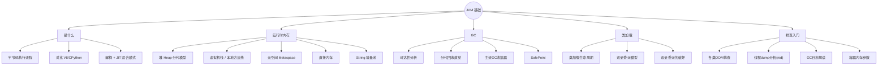
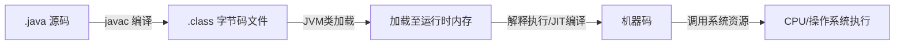
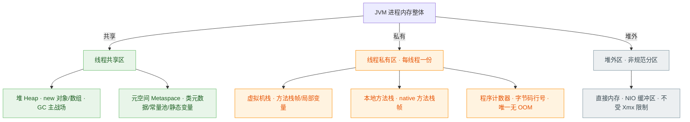
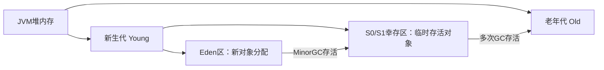
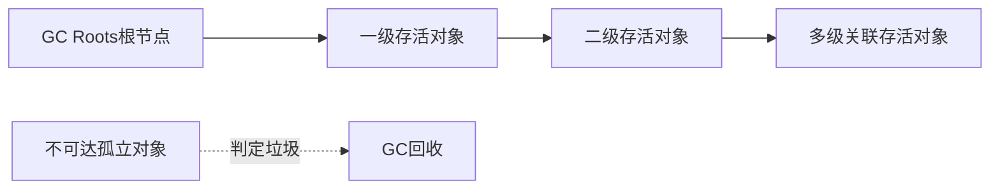
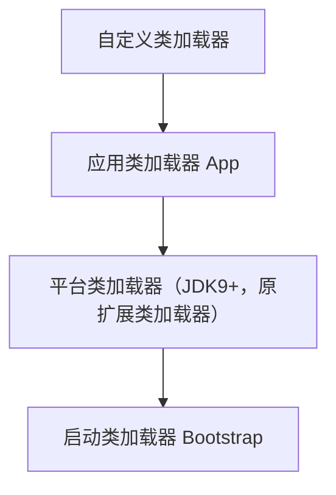
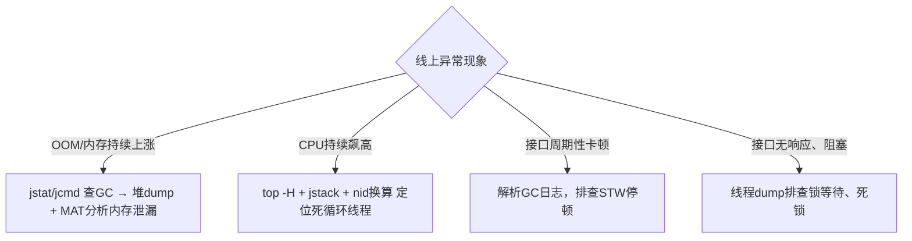

# JVM 基础：内存、GC、类加载与排查入门（修订版）
> 面向 JS + Python 背景开发者。
> 目标：建立 JVM 运行时心智模型（堆/栈/元空间）、GC 与常见收集器直觉、类加载过程，以及 OOM / CPU 飙高 / 卡顿时的基本排查路径。
> 本版在原笔记基础上：修正内存分区、CMS 时间线、G1 分代表述与类卸载条件；新增对象分配细节、双亲委派破坏场景、String 常量池、容器内存参数、OOM 自动 dump、jstat/jps 与 nid 换算等实战内容。

## TL;DR（先看结论）
💡 一句话结论：**JVM = 跑字节码的虚拟机：类元数据进方法区/元空间（Class 对象本身在堆），对象主要活在堆，线程私有栈帧在栈上；GC 自动回收堆垃圾。** 对比 V8 / CPython，你要多关心「堆大小、GC 停顿、类加载泄漏、线程 dump」四大核心问题。
- **内存分区**：堆（对象实例） / 虚拟机栈（方法帧） / 本地方法栈 / 元空间（类元数据） / 程序计数器；另有**直接内存**（堆外 NIO，非规范分区）
- **GC核心**：可达性分析判定垃圾；分代回收适配对象生命周期；生产主流G1、低延迟场景ZGC
- **类加载**：七步生命周期 + 双亲委派模型；热部署、类泄漏均和自定义类加载器相关
- **排查三板斧**：jstat/jcmd/jmap 查内存、jstack 查线程、GC日志分析停顿与回收效率
- **高频线上坑**：堆参数不合理、频繁Full GC、内存泄漏、线程溢出、忽略堆外内存OOM、容器 cgroup 限制、String.intern 滥用

## 🗺️ 本笔记知识地图

## 0. 前置认知：跨语言运行时对比
💡 核心差异：JS/Python 运行时封装度更高，Java JVM 暴露完整调优参数、工具链和内存模型，需要主动感知运行时风险（三语言详细对比表见 §8）。

本篇核心掌握：**内存分区边界、GC垃圾回收逻辑、类加载机制、线上故障排查流程**，实现从「会用Java」到「懂JVM运行」的过渡。

## 1. JVM 核心定义与执行流程
💡 一句话结论：JVM 是跨平台字节码虚拟机，将Java源码编译的 `.class` 文件，通过解释器+JIT编译器转换为系统可执行的机器码，实现「一次编译，到处运行」。

### 1.1 完整执行链路


### 1.2 主流语言运行时对比
- **Java**：静态编译字节码 + JIT即时编译 + 可控GC，适合高性能服务端
- **Node**：动态解释执行，V8内置JIT，无复杂内存调优
- **Python**：动态解释+pyc字节码，引用计数为主GC，几乎无需人工调优

> **补充：解释与 JIT 混合模式**。HotSpot 默认 `-Xmixed`：启动阶段先解释执行（启动快），热点代码被 JIT 编译为本地机器码（长期性能好）；纯解释（`-Xint`）与纯编译（`-Xcomp`）只用于特殊场景。JIT 有冷启动预热问题，压测对比需等预热完成，否则数据失真。

日常 `java -jar app.jar` 本质：启动JVM进程 → 加载SpringBoot容器类 → 初始化环境 → 运行业务代码。

## 2. JVM 运行时内存区域（核心重点）
💡 一句话结论：内存分区**线程私有**（虚拟机栈、本地方法栈、程序计数器）、**线程共享**（堆、元空间）；**直接内存**是 JVM 规范之外的堆外区。90%线上OOM问题，均可定位到具体分区。

### 2.1 内存分区总览（修订：规范五区 + 堆外区）


### 2.2 分区详细说明（修订：补齐本地方法栈，区分直接内存）
|内存区域|归属特性|存储内容|异常场景|
|---|---|---|---|
|堆 Heap|线程共享，GC主战场|所有new实例、数组、集合对象|Java heap space OOM|
|虚拟机栈|线程私有，随线程销毁|栈帧（局部变量表、操作数栈、动态链接、方法出口）|StackOverflowError、栈OOM|
|本地方法栈|线程私有，随线程销毁|native 方法（C/C++）的栈帧|StackOverflowError|
|元空间|线程共享，JDK8+替代永久代|类结构、方法、常量、注解、动态生成类|Metaspace OOM（类泄漏）|
|程序计数器|线程私有|当前线程执行的字节码行号|无（唯一无 OOM 区域）|
|直接内存|堆外，非规范分区，不受Xmx限制|NIO ByteBuffer、网络缓冲区|Direct buffer memory OOM|

> **补充：String 字符串常量池**。JDK7 起字符串常量池从方法区移入堆：`intern()` 会把字符串复制进常量池并长期驻留，滥用是线上 Full GC / OOM 的隐性来源，排查内存问题时优先排查它。元空间中的「运行时常量池」与堆中的「字符串常量池」是两个东西，面试常考区别。

### 2.3 堆分代模型（修正：G1 逻辑分代 + 物理分区）

- **新生代**：对象朝生夕死，Minor GC频繁、停顿短、效率高
- **老年代**：长期存活对象，回收频率低、开销大、易触发FullGC
- **对象晋升**：新生代熬过多次GC后，迁移至老年代长期存储
- **大对象**：超过阈值的大对象直接进入老年代（`-XX:PretenureSizeThreshold`，仅 Serial/Parallel 生效；G1 下进入专门的大对象区 Humongous Region），避免在新生代反复拷贝

> **修正说明**：G1 在逻辑上**仍然分代**（新生代/老年代），只是物理上划分为 Region 分区；ZGC 才默认不分代（JDK21 起提供分代模式）。"弱化分代"的说法不准确，应为"分区化"。

### 2.4 对象分配细节（新增）
- **TLAB（线程本地分配缓冲）**：每个线程在 Eden 划一小块私有缓冲区，对象分配优先走 TLAB，避免多线程竞争 Eden 锁，默认开启（`-XX:+UseTLAB`）
- **对象访问定位**：HotSpot 采用**直接指针**访问（引用直接指向堆中对象），而非句柄池方式
- **逃逸分析**：JIT 发现对象不逃逸方法时，可做**栈上分配/标量替换**（对象不落堆，直接消灭），是"GC 减少对象"的底层优化之一

### 2.5 虚拟机栈调用机制
方法嵌套调用对应栈帧入栈/出栈，和前端调用栈逻辑一致，核心差异：**Java每条线程独立栈，线程越多，栈内存总占用越高**（可通过`-Xss`调优单栈大小）。递归无边界、方法嵌套过深 → `StackOverflowError`（栈溢出而非堆溢出）。

## 3. GC垃圾回收机制（核心）
💡 一句话结论：JVM通过**可达性分析**判定垃圾，自动回收堆内存无效对象；所有GC均存在STW停顿，核心优化目标是「降低停顿、减少GC频率」。

### 3.1 垃圾判定：可达性分析
摒弃Python的引用计数（无法解决循环引用），JVM采用根搜索算法：从GC Roots出发，遍历可达对象为存活对象，不可达即为可回收垃圾。

**常见GC Roots**：线程栈局部变量、静态字段/常量引用、本地方法JNI引用、加载的Class对象、系统类引用

### 3.2 四大引用类型
|引用类型|特性|回收规则|业务场景|
|---|---|---|---|
|强引用|默认引用|永不回收，直至OOM|常规业务对象|
|软引用|内存敏感|内存不足时回收|图片缓存、临时缓存|
|弱引用|生命周期最短|只被弱引用可达时下次GC必回收|防内存泄漏、缓存兜底|
|虚引用|无实际引用作用|对象回收后收到入队通知|堆外内存监控|

> 软/弱引用可配合 `ReferenceQueue`：引用对象被回收时，引用本身会入队，业务可据此清理关联资源（如 DirectBuffer 的回收）。

### 3.3 主流GC收集器对比（修正：CMS 时间线；新增 Shenandoah）
|收集器|核心特点|适用场景|版本状态|
|---|---|---|---|
|Serial|单线程回收、简单高效、STW长|客户端、小内存应用|老旧、基本淘汰|
|Parallel|多线程、高吞吐量、不关注延迟|后台批量任务、离线服务|**JDK8默认**（Parallel Scavenge + Parallel Old）|
|CMS|并发低延迟、内存碎片多|早期低延迟业务|**JDK9标记废弃、JDK14移除**，仅遗留系统使用|
|**G1**|分区回收、可控停顿、吞吐延迟兼顾|线上大堆、通用Web服务|**JDK9+默认**（逻辑分代+物理分区）|
|ZGC|超低STW、超大堆适配、几乎无停顿|延迟敏感、超大集群服务|JDK11实验、**JDK15转正**；默认不分代，JDK21+有分代模式|
|Shenandoah|超低延迟，与ZGC并列|低延迟场景（RedHat主导）|JDK12引入，实验性质居多|

> **G1 内部机制（进阶）**：堆划分为多个 Region，用 RSet（记忆集）记录跨 Region 引用，通过「停顿预测模型」控制目标停顿时间（`-XX:MaxGCPauseMillis`）；触发 Mixed GC 的堆占用阈值是 `-XX:InitiatingHeapOccupancyPercent`（默认45%）。入门只需知道：G1 用"可预期停顿"换吞吐，是最通用的线上选择。

### 3.4 GC触发与OOM逻辑
- **Minor GC**：Eden区无法为新对象分配空间时触发，频率高、速度快
- **Full GC**：老年代不足、晋升失败（担保失败）、手动`System.gc()`触发，开销极大；G1 下可用 `-XX:+ExplicitGCInvokesConcurrent` 把显式 GC 转为并发
- **OOM触发条件**：多次GC回收后，堆/元空间/直接内存仍无足够空间分配新对象

### 3.5 SafePoint 安全点（新增）
GC 发生前，所有线程必须先执行到**安全点**（SafePoint）才能被暂停（STW）。安全点出现在方法调用、循环回边、异常跳转等位置；长时间无安全点的线程（如纯运算循环）会让 GC 等待，表现为"GC 日志里 safepoint 等待时间过长"。排查 STW 时可留意。

## 4. 类加载机制
💡 一句话结论：Java类不会直接加载到内存，遵循完整生命周期；双亲委派模型保障核心类安全，是理解热部署、类泄漏、SpringBoot打包的关键。

> **衔接 §2 / §5**：类加载的产物——类元数据——存放在 §2 的元空间（Metaspace）中；动态生成类过多或类加载器泄漏（热部署残留），会直接引发 §5 的 Metaspace OOM。类加载是内存问题的"上游"，先记住这条链路，后面排查时直接对应。

### 4.1 类完整生命周期

核心阶段释义：
- **加载**：读取 `.class` 文件，生成内存 Class 对象（类元数据进元空间，Class 对象本身在堆）
- **验证**：校验字节码合法性，防止恶意代码
- **准备**：静态变量分配内存，赋默认初始值（编译期 `final` 常量例外，直接进常量池）
- **解析**：符号引用替换为直接引用；HotSpot 中解析是**惰性**的，可延迟到初始化之后才发生
- **初始化**：执行静态代码块、静态变量赋值（触发 `<clinit>` 方法）
- **卸载**：满足"该类所有实例已回收、ClassLoader 不可达、Class 对象不可达"即可被卸载——**任何类加载器场景都适用**，只是自定义类加载器场景最容易发生（修正原文"仅自定义类加载器可实现"）

### 4.2 双亲委派模型
核心规则：类加载器优先委托父加载器加载，父加载器无法加载时，自身才加载，避免核心类被篡改、重复加载。


### 4.3 双亲委派的破坏（新增）
- **JDBC SPI**：`DriverManager` 是启动类加载器加载的，但 JDBC 驱动在应用 classpath 上——只能通过**线程上下文类加载器（TCCL）**反过来加载，即"父加载器委托子加载器"
- **Tomcat 等容器**：每个 Web 应用一个独立类加载器，实现应用间隔离与热部署，同样打破双亲委派
- 面试要点：双亲委派是"默认安全机制"，SPI 与容器场景是"有意的破坏"，两者都要能说清

### 4.4 业务落地场景
- 动态生成类、Groovy脚本、热部署 → 频繁创建Class对象 → 元空间溢出
- 热部署残留旧类加载器 → 类元数据无法卸载 → 隐形内存泄漏
- SpringBoot胖jar → 自定义类加载器加载jar内资源，区别于普通本地运行

## 5. 常见异常与JVM核心参数
💡 一句话结论：先识别异常类型，再针对性调参；盲目加大堆内存，只会延后OOM，无法解决泄漏问题。

### 5.1 高频OOM异常对照表
|异常信息|根因定位|解决方向|
|---|---|---|
|Java heap space|堆对象过多、集合未释放、堆内存过小|排查内存泄漏、优化对象生命周期、合理调大Xmx|
|GC overhead limit exceeded|GC频繁执行，回收效率极低|存在严重内存泄漏，优先排查代码|
|Metaspace OOM|动态类过多、类加载器泄漏|限制动态生成类、修复热部署泄漏|
|Compressed class space OOM|元空间内压缩类空间（默认约1GB）耗尽|调大 `-XX:CompressedClassSpaceSize`，排查类泄漏|
|Direct buffer memory|堆外NIO内存耗尽|释放无效堆外缓冲区、限制直接内存大小|
|unable to create new native thread|线程数量超出系统限制|优化线程池、限制最大线程数|
|StackOverflowError|递归过深、方法嵌套过多|优化递归逻辑、适当调大Xss|

### 5.2 高频生产JVM参数（修订：新增 OOM 自动 dump、容器参数、JDK8/9 日志差异）
|参数|作用说明|生产建议|
|---|---|---|
|\-Xms|JVM堆初始内存|与Xmx设置相同，避免堆动态扩容开销|
|\-Xmx|JVM堆最大内存|容器场景不按物理内存比例，见 MaxRAMPercentage|
|\-Xss|单线程栈内存大小|业务线程默认即可，递归场景适当调大|
|\-XX:MaxMetaspaceSize|元空间最大上限|**必配**：元空间默认无上限（仅受本地内存限制），防无限膨胀|
|\-XX:MaxDirectMemorySize|直接内存上限|默认约等于Xmx，NIO 密集场景显式设置|
|\-XX:MaxRAMPercentage|按容器配额取堆比例（JDK8u191+）|容器部署推荐 75 左右，配合 cgroup 使用|
|\-XX:+HeapDumpOnOutOfMemoryError|OOM 时自动导出堆快照|**生产必开**，配合 `-XX:HeapDumpPath=/data/logs/heap.hprof`|
|\-XX:\+UseG1GC|启用G1垃圾收集器|JDK9+默认，通用生产方案|
|JDK8: \-XX:+PrintGCDetails \-Xloggc:gc.log|输出GC日志（JDK8）|JDK8 生产必开|
|JDK9+: \-Xlog:gc\*|输出GC日志（JDK9+）|JDK9+ 统一日志语法，与 JDK8 不通用|

**生产启动示例（容器版，修订）：**
```bash
java -Xms512m -Xmx512m -XX:MaxRAMPercentage=75.0 -XX:MaxMetaspaceSize=256m \
     -XX:+HeapDumpOnOutOfMemoryError -XX:HeapDumpPath=/data/logs/heap.hprof \
     -Xlog:gc*:file=gc.log:time,uptime -jar app.jar
```

## 6. 线上故障排查三板斧
💡 一句话结论：线上问题先定性（内存/CPU/线程/GC），再用对应命令取证，不盲目重启服务。

### 6.1 排查决策流程


### 6.2 内存问题排查命令（修订：补 jps/jstat；标注 histo 的 STW 风险）
```bash
jps -l                              # 1. 找 Java 进程 PID
jinfo -flags <pid>                  # 2. 查看 JVM 启动参数（确认 Xmx、GC 器等）
jstat -gcutil <pid> 1000            # 3. 实时监控：YGC/FGC 次数、耗时、各区使用率（排查第一步，最轻量）
jcmd <pid> GC.heap_info             # 4. 查看堆内存实时信息
jmap -histo:live <pid>              # 5. 存活对象统计（⚠ 会触发一次 Full GC，生产大堆慎用）
jcmd <pid> GC.heap_dump /tmp/heap.hprof   # 6. 导出堆快照（大堆会 STW，低峰期操作）
```
分析工具：Eclipse MAT、VisualVM，重点查看**支配树（Dominator Tree）**，定位大对象、常驻缓存泄漏。

### 6.3 CPU/线程问题排查命令（修订：补全 nid 换算步骤）
```bash
top -H -p <pid>                     # 1. 找到 CPU 占用最高的线程 TID（十进制）
printf "%x\n" <TID>                 # 2. 十进制转十六进制（如 12345 → 0x3039）
jstack <pid> > threaddump.txt       # 3. 导出线程快照
# 4. 在 threaddump.txt 中搜索 "nid=0x3039"，直接定位到该线程的代码行
```
排查重点：线程死锁、BLOCKED阻塞、RUNNABLE死循环、线程数溢出（无界线程池）。

### 6.4 GC日志排查重点
- YoungGC频率过高：对象分配过快、Eden区内存过小
- GC停顿时间过长：大堆回收、FullGC频繁
- 堆内存回收后立即高位：存在内存泄漏
- safepoint 等待时间过长：存在长时间不进安全点的线程（见 §3.5）
- 注意日志参数版本差异：JDK8 用 `-XX:+PrintGCDetails -Xloggc:gc.log`，JDK9+ 用 `-Xlog:gc*`，二者语法不通用

## 7. SpringBoot 业务常见JVM问题
- 本地静态Map/ConcurrentHashMap无过期清理 → 堆内存泄漏OOM
- 动态生成类、Groovy脚本、热部署 → 元空间持续上涨溢出
- 无界线程池 + 阻塞任务 → 线程数爆炸，无法创建新线程
- 一次性加载大List、大JSON → 新生代频繁GC
- parallelStream占用公共线程池（ForkJoinPool.commonPool）→ 全局业务卡顿
- **容器部署默认堆大小**：Spring Boot 2.x 默认堆为物理内存的 1/4，容器里必须用 `-XX:MaxRAMPercentage` 显式控制，否则可能撞 cgroup 限制

核心结论：**90%线上JVM问题，根源是代码问题，而非JVM参数问题**，调参只是优化手段，代码优化才是根治方案。

## 8. 跨语言运行时最终对比（合并 §0 差异化信息）
|对比维度|JVM\(Java\)|V8\(Node\)|CPython|
|---|---|---|---|
|运行模式|静态编译字节码 + JIT|动态解释 + V8内置JIT|动态解释 + pyc字节码|
|对象存储|堆内存|堆内存|堆内存|
|多线程能力|真并行、多独立栈|单线程串行|假并行（GIL锁）|
|GC机制|分代/分区追踪GC|分代GC|引用计数\+分代GC|
|调优方式|参数\+日志\+dump全方位调优|仅堆大小简单限制|几乎无需调优|
|故障取证|jstack/jmap/jstat/MAT全套工具|heapdump、控制台分析|基础日志排查|

## 9. 生产高频坑点总结（修订：新增 2 条）
1. 盲目加大`-Xmx`：掩盖内存泄漏，导致GC停顿更严重
2. 堆内存超出容器cgroup限制：被系统随机kill，无报错日志 → **用 `-XX:MaxRAMPercentage` 按配额设置**
3. 生产频繁dump堆快照：大堆场景引发长时间STW，服务卡顿
4. 只关注堆内存，忽略元空间、直接内存OOM
5. 递归逻辑无限制，引发栈溢出而非堆溢出
6. 线程池无界配置，导致线程爆炸、系统资源耗尽
7. 误将GC停顿问题，判定为业务锁、代码阻塞问题
8. 本地开发正常、线上OOM：环境默认JVM参数差异导致
9. 日志、临时集合无限累加，造成隐性内存泄漏
10. 压测忽略JIT预热，冷启动性能对比数据失真
11. **`jmap -histo:live` 会触发 Full GC**：生产大堆误用会引发长时间停顿
12. **滥用 `String.intern()`**：字符串常量池（堆中）持续膨胀，引发 Full GC / OOM

## 10. 核心知识点小结
|核心模块|核心记忆点|
|---|---|
|堆内存|对象存储核心区，GC、OOM高发区，分代回收|
|虚拟机栈|线程私有，存储方法栈帧，递归过深栈溢出|
|元空间|存储类元数据，动态类、热部署易引发泄漏|
|GC机制|可达性分析判垃圾，所有GC均有STW，优先优化代码|
|类加载|双亲委派保安全，七步生命周期，自定义加载器易泄漏|
|故障排查|先定性问题，再dump取证，最后调优修复|

**极简口诀**：对象看堆，调用看栈，类看元空间，字符串看常量池；出事先定性（内存/CPU/GC），取证再修复。

## 11. 实操练习建议（修订：新增 3 条）
1. 自定义无限添加集合代码，小堆参数模拟`Java heap space` OOM
2. 编写无限递归方法，模拟`StackOverflowError`
3. 启动SpringBoot，通过 jcmd/jstat 查看实时堆内存、GC 频率与 JVM 参数
4. 导出线程dump，识别业务线程、Tomcat工作线程
5. 开启GC日志，压测后解读YoungGC、FullGC日志信息
6. 手动构造静态缓存泄漏，用MAT定位泄漏对象
7. 对比Node堆内存限制与JVM堆参数的差异
8. 调研ZGC低延迟收集器的版本适配与生产使用场景
9. **写一段 `String.intern()` 循环代码，小堆模拟字符串常量池膨胀，观察 Full GC 曲线**
10. **在容器里分别用固定 `-Xmx` 与 `-XX:MaxRAMPercentage` 启动，观察内存配额差异**

## 12. 下篇预告
下一篇：**实战项目：RESTful 后端系统**
核心重点：
- 整合分层架构、REST接口、参数校验、全局异常处理
- MyBatis-Plus实战、多环境配置、日志规范、Actuator监控
- 项目测试、打包、部署完整流程
- 结合并发、JVM知识梳理线上上线检查清单

阶段5（并发+JVM）核心内容完结，下篇进入项目实战收口阶段！