# JVM 基础：内存、GC、类加载与排查入门
>
> 面向 JS + Python 背景开发者。
> 目标：建立 JVM 整体架构及运行时心智模型（堆/栈/元空间）、CMS 时间线、GC 与常见收集器直觉、类加载过程，以及 OOM / CPU 飙高 / 卡顿时的基本排查路径。
---
## TL;DR（先看结论）
💡 一句话结论：**JVM = 跑字节码的虚拟机：类元数据进方法区/元空间（Class 对象本身在堆），对象主要活在堆，线程私有栈帧在栈上；GC 自动回收堆垃圾。**
对比 V8 / CPython，你要多关心「堆大小、GC 停顿、类加载泄漏、线程 dump」四大核心问题。
- **内存分区**：堆（对象实例） / 虚拟机栈（方法帧） / 本地方法栈 / 元空间（类元数据） / 程序计数器；另有**直接内存**（堆外 NIO，非规范分区）
- **对象的一生**：创建 → TLAB 分配 → 逃逸分析 → 晋升 → 回收，是串起内存与 GC 的主线
- **GC 核心**：可达性分析 + 三色标记判定垃圾；分代回收适配对象生命周期；生产主流 G1、低延迟场景 ZGC
- **JMM**：happens-before + 内存屏障，决定多线程下的可见性与有序性
- **类加载**：七步生命周期 + 双亲委派模型；热部署、类泄漏均和自定义类加载器相关
- **执行引擎**：解释器保证启动快，JIT 让热点代码越跑越快；CodeCache 打满会退化解释执行
- **排查三板斧**：jstat/jcmd/jmap 查内存、jstack 查线程、GC 日志分析停顿与回收效率
- **高频线上坑**：堆参数不合理、频繁 Full GC、内存泄漏、线程溢出、忽略堆外内存 OOM、容器 cgroup 限制、String.intern 滥用
---

## 🗺️ 本笔记知识地图
```mermaid
flowchart TB
    ROOT(("JVM 基础"))
    ROOT --> H["跨语言运行时对比（前置）"]
    ROOT --> A["JVM 是什么：整体架构 & 字节码"]
    ROOT --> D["类加载机制"]
    ROOT --> B["运行时内存区域"]
    ROOT --> O["对象的一生"]
    ROOT --> C["GC 垃圾回收机制"]
    ROOT --> EXE["执行引擎：解释器 + JIT + 代码缓存"]
    ROOT --> M["JMM 内存模型"]
    ROOT --> E["异常、JVM 参数 & 调优"]
    ROOT --> F["线上故障排查"]
    ROOT --> G["SpringBoot 业务常见 JVM 问题"]
    ROOT --> I["生产高频坑点总结"]
    ROOT --> J["核心知识点小结"]
    ROOT --> K["实操练习建议"]
    H --> H1["JVM / V8 / CPython对比表"]
    A --> A1["JVM 四大子系统"]
    A --> A2["字节码初识"]
    D --> D1["类加载完整生命周期"]
    D --> D2["双亲委派模型"]
    D --> D3["双亲委派的破坏"]
    D --> D4["业务落地场景"]
    B --> B1["堆 Heap 分代模型"]
    B --> B2["虚拟机栈 / 本地方法栈 / 栈帧"]
    B --> B3["元空间 Metaspace"]
    B --> B4["程序计数器"]
    B --> B5["直接内存"]
    B --> B6["String 常量池"]
    O --> O1["对象创建流程"]
    O --> O2["TLAB 分配"]
    O --> O3["逃逸分析"]
    O --> O4["对象头与指针压缩"]
    O --> O5["对象晋升与回收"]
    C --> C1["可达性分析 & GC Roots"]
    C --> C2["三色标记 & 并发标记问题"]
    C --> C3["三大基础GC算法"]
    C --> C4["四大引用类型"]
    C --> C5["主流GC收集器演化"]
    C --> C6["GC触发 & OOM逻辑"]
    C --> C7["SafePoint 安全点"]
    EXE --> EXE1["解释器 & 混合模式"]
    EXE --> EXE2["热点探测"]
    EXE --> EXE3["C1 / C2 分层编译"]
    EXE --> EXE4["方法内联 & OSR"]
    EXE --> EXE5["代码缓存 Code Cache"]
    M --> M1["主内存 & 工作内存"]
    M --> M2["happens-before"]
    M --> M3["内存屏障"]
    M --> M4["volatile / synchronized"]
    E --> E1["高频OOM异常对照表"]
    E --> E2["生产常用JVM参数"]
    E --> E3["调优方法论"]
    F --> F1["排查决策流程"]
    F --> F2["内存排查命令"]
    F --> F3["CPU/线程排查命令"]
    F --> F4["GC日志解读要点"]
    F --> F5["进阶诊断工具"]
    G --> G1["SpringBoot典型JVM问题"]
    I --> I1["线上踩坑清单"]
    J --> J1["知识点速记"]
    K --> K1["动手实验清单"]
```
---

## 0. 前置认知：跨语言运行时对比
💡 核心差异：JS/Python 运行时封装度更高，Java JVM 暴露完整调优参数、工具链和内存模型，需要主动感知运行时风险。
- **Java**：静态编译字节码 + JIT 即时编译 + 可控 GC，适合高性能服务端
- **Node**：动态解释执行，V8 内置 JIT，无复杂内存调优
- **Python**：动态解释 + pyc 字节码，引用计数为主 GC，几乎无需人工调优
本篇核心掌握：**内存分区边界、对象生命周期、GC 垃圾回收逻辑、JMM 内存模型、类加载机制、线上故障排查流程**，实现从「会用 Java」到「懂 JVM 运行」的过渡。

### 0.1 JVM / V8 / CPython 对比表
| 对比维度 | JVM(Java) | V8(Node) | CPython |
| --- | --- | --- | --- |
| 运行模式 | 静态编译字节码 + JIT | 动态解释 + V8 内置 JIT | 动态解释 + pyc 字节码 |
| 对象存储 | 堆内存 | 堆内存 | 堆内存 |
| 多线程能力 | 真并行、多独立栈 | 单线程串行 | 假并行（GIL 锁） |
| GC 机制 | 分代/分区追踪 GC | 分代 GC | 引用计数 + 分代 GC |
| 调优方式 | 参数 + 日志 + dump 全方位调优 | 仅堆大小简单限制 | 几乎无需调优 |
| 故障取证 | jstack/jmap/jstat/MAT/JFR/Arthas | heapdump、控制台分析 | 基础日志排查 |
>
> 记忆锚点：JVM 给你"全套仪表盘"（参数/日志/dump），Node 只给"油箱表"（堆大小），Python 几乎"免维护"——所以学习重点放在 JVM 需要你主动感知的部分。
---

## 1. JVM 是什么
> 一句话结论：JVM 是跨平台字节码虚拟机，将 Java 源码编译的 `.class` 文件，通过解释器 + JIT 编译器转换为系统可执行的机器码，实现「一次编译，到处运行」。

### 1.1 JVM 整体架构
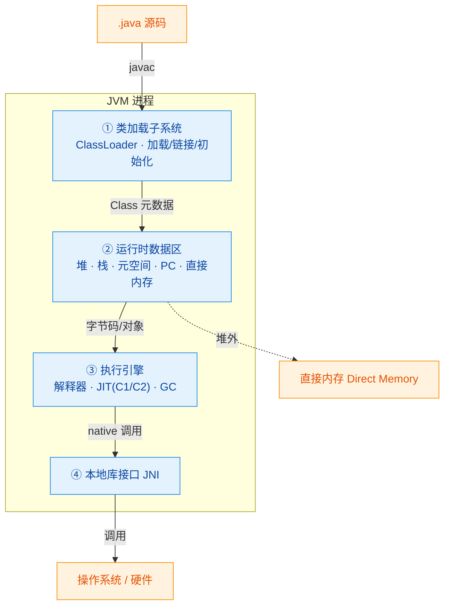
四大子系统一句话职责：
| 子系统 | 职责 | 关键产物 |
| --- | --- | --- |
| **类加载子系统** | 读 `.class` → 生成类元数据 + Class 对象 | 元空间元数据、堆中 Class 对象（详见 §2） |
| **运行时数据区** | 存放运行期数据 | 堆、栈、元空间、PC、直接内存（详见 §3） |
| **执行引擎** | 解释执行 + JIT 编译 + GC | 机器码、回收后的堆（详见 §6） |
| **本地库接口 JNI** | 调 native 方法（C/C++） | 系统调用 |
>
> 主线：**类加载器 → 元数据/Class 对象 → 运行时数据区 → 执行引擎 → 机器码/GC**。

### 1.2 完整执行链路
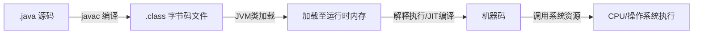
日常 `java -jar app.jar` 本质：启动 JVM 进程 → 加载 SpringBoot 容器类 → 初始化环境 → 运行业务代码。

### 1.3 字节码初识
javac 编译时 生成 `.class` 字节码，其结构决定了栈帧、常量池、动态链接的存在方式。
    - 如果类里有静态变量赋值或 static {} 块，编译器会把它们合并成 <clinit>() 方法写入 .class；
    - 如果没有静态变量显式赋值、也没有静态块，编译器可能根本不会生成 <clinit>()。
**核心结构**（`javap -v` 查看）：
- **魔数** `0xCAFEBABE`（文件头，验证阶段校验）
- **版本号**（主/次，如 52 = JDK8）
- **常量池**：字符串、类名、方法名的"符号引用池"
- **访问标志 / 类索引 / 父类索引 / 接口表**
- **字段表 / 方法表**：每个方法编译成一段字节码指令序列
- **属性表**：Code 属性（方法体字节码）、异常表、LineNumberTable 等
**字节码指令示例**
译期常量表达式，javac 通常会直接常量折叠。
```java
int a = 1 + 2;
// 字节码指令
0: iconst_3 // 压入常量 3
1: istore_1 // 把栈顶存到局部变量表 slot 1
2: return // 返回
```

```java
int x = 1;
int y = 2;
int a = x + y;
// 字节码指令
0: iconst_1 // 压入常量 1
1: istore_1 // 把栈顶存到局部变量表 slot 1
2: iconst_2 // 压入常量 2
3: istore_2 // 把栈顶存到局部变量表 slot 2
4: iload_1   // 弹出一个 int
5: iload_2   // 弹出一个 int
6: iadd      // 弹出两个 int，相加后压回结果 3
7: istore_3  // 把栈顶存到局部变量表 slot 3
8: return     // 返回
```

**常用指令族**
| 指令族 | 含义 | 示例 |
| --- | --- | --- |
| `load` / `store` | 局部变量表 ↔ 操作数栈 | `iload_1`、`istore_2` |
| `const` / `push` | 压入常量 | `iconst_1`、`ldc` |
| `add` / `sub` / `mul` | 算术运算 | `iadd`、`lmul` |
| `invoke*` | 方法调用 | `invokevirtual`、`invokestatic`、`invokedynamic` |
| `new` / `newarray` | 创建对象/数组 | `new #2` |
| `if*` / `goto` | 控制转移 | `if_icmpeq`、`goto` |
| `athrow` | 抛异常 | — |
>
> 概念对应：字节码里的"符号引用"（`Lcom/demo/User;`）→ §3.4.1 动态链接 → 运行时解析成"直接引用"。
---

## 2. 类加载机制
💡 一句话结论：Java 类不会直接加载到内存，而是遵循完整生命周期；双亲委派模型保障核心类安全，是理解热部署、类泄漏、SpringBoot 胖 jar 的关键。
>
> 类元数据存放在元空间（JDK8+）；Class 对象实例在堆。动态生成类、热部署残留类加载器会引发 Metaspace OOM。

### 2.1 类完整生命周期


**阶段释义**：

- **加载**：读取 `.class` 字节流，在元空间生成类元数据，同时在堆中创建 Class 对象
- **验证**：校验字节码合法性，防止恶意、畸形字节码破坏JVM
- **准备**：静态变量分配内存，赋默认零值；编译期 `static final` 基础类型常量例外，直接赋予代码定义值
- **解析**：常量池中的符号引用替换为直接引用；HotSpot 默认支持**惰性解析（晚期绑定）**，可延迟至初始化阶段之后执行，用于支持多态
- **初始化**：执行静态变量显式赋值、静态代码块，执行 `<clinit>` 方法；JVM保证该方法线程安全，一个类只会初始化一次
- **使用**：业务代码实例化对象、调用类的字段/方法，正常使用类
- **卸载**：**必须同时满足3个条件**：该类所有实例全部被回收、加载该类的ClassLoader不可达、该类对应的Class对象无任何引用，类才允许卸载；自定义类加载场景最容易出现类泄漏

> 其中 验证、准备、解析 合称 连接（Linking）。
> 
> 卸载由GC触发，**类加载器无法主动卸载类**。

#### 2.1.1 加载 → 初始化详解

**1. 加载 Loading（类加载器唯一负责阶段）**

`ClassLoader` 的三个核心方法：`loadClass` / `findClass` / `defineClass`
> 
> 1. `loadClass(String name)`：加载入口，**内置双亲委派逻辑**。先检查缓存是否已加载；未加载则向上委托父加载器；父加载器全部加载失败，才调用本加载器的`findClass`。一般不建议重写，重写容易破坏双亲委派。
> 2. `findClass(String name)`：ClassLoader基类中默认空实现，直接抛出`ClassNotFoundException`。**自定义类加载器重写此方法**，实现在方法内读取class字节流byte[]，随后调用defineClass。
> 3. `defineClass(name, byte[], offset, len)`：final原生方法，不可重写。接收字节数组，JVM解析字节码；该方法仅完成【加载阶段】，**不会自动触发链接（验证/准备/解析）和类初始化**。

1. 类加载器读取字节流，来源不限于本地class文件：本地jar/class、网络传输、内存动态生成字节码（ASM/CGLIB）等
2. 在**元空间**保存类元数据：类名、父类、接口、字段、方法、字节码、运行时常量池、注解泛型信息
3. `defineClass` 在**堆**创建 `java.lang.Class` 对象，作为Java层访问类元数据的入口(指针)

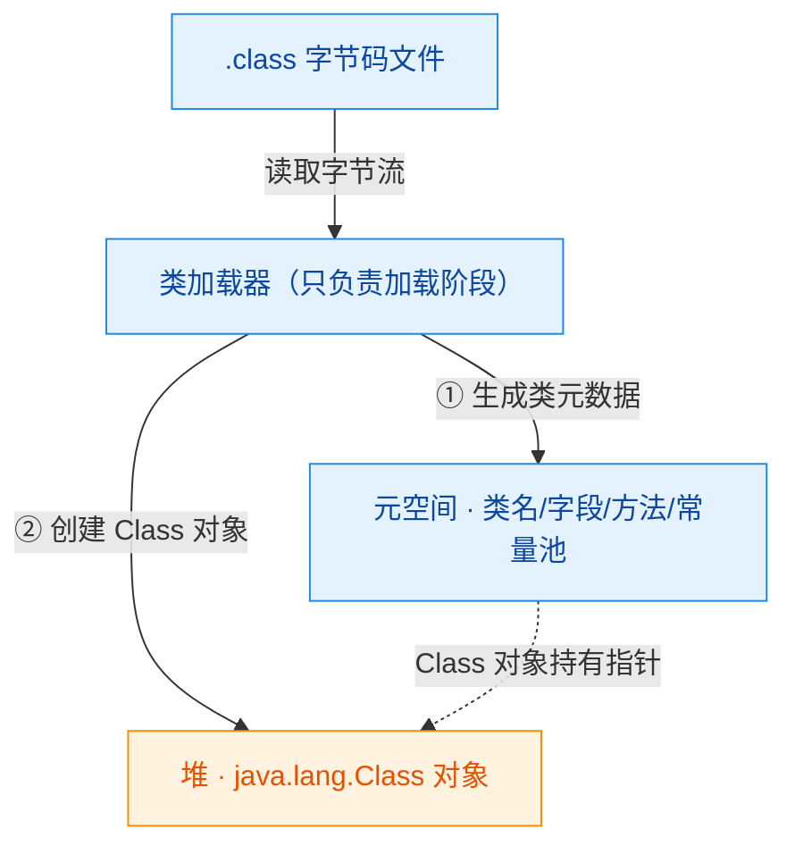

**类加载触发时机**
JVM采用**懒加载**策略，不会在程序启动时一次性加载全部类。**当运行时需要使用该类，并且该类尚未加载时，触发类加载**；

> 
> ⚠️ 区分：触发【加载】 ≠ 触发【类初始化`<clinit>`】。加载只是读取字节码生成元数据与Class对象；初始化需要满足主动使用条件才执行。

✅ 会触发类加载：

1. new 创建类实例；
2. 调用类静态方法、读取类静态字段；
3. 反射操作：`Class.forName()`、`ClassLoader.loadClass()`；
4. 加载子类时，预先加载父类；
5. 程序入口main主类启动加载；
6. ASM/CGLIB动态字节码，手动调用defineClass加载。

❌ 被动引用，**不会触发目标类加载**：

1. 仅将类作为变量、方法入参/返回值类型；
2. 创建该类的数组 `User[] arr = new User[10]`，只会创建数组类，不会加载元素User类；
3. 访问`static final`编译期常量，常量在编译期已经嵌入调用方字节码，不触发目标类加载。

> 
> 补充：`ClassLoader.loadClass()` 会触发**加载**，但默认**不会触发类初始化**。

**2. 验证 Verification**
四类校验：文件格式魔数校验、元数据校验、字节码指令流校验、符号引用校验，防止恶意字节码攻击、非法字节码导致JVM崩溃。

- 文件格式校验：校验class文件魔数`0xCAFEBABE`、版本号，确保是合法class文件；
- 元数据校验：检查类结构、继承关系，防止非法继承；
- 字节码校验：检查指令是否合法，保证不会出现非法操作栈溢出等危险指令；
- 符号引用校验：校验常量池引用目标是否合法。

**3. 准备 Preparation**
在元空间中为静态变量分配内存，并赋予默认零值(`0`/`false`/`null`/...)；
- `static final` 编译期基础类型常量在准备阶段直接赋值；
- 实例变量不在此阶段分配内存，实例变量是在new对象时，随对象创建分配在堆中；

**4. 解析 Resolution**
class文件常量池里字符串形式的**符号引用**，转换为指向内存地址的**直接引用**；
- `invokedynamic`、lambda表达式支持运行时动态解析；
- 静态解析：编译期即可确定引用目标；
- 动态解析（晚期绑定）：运行时确定目标，用来实现多态。
 
**5. 初始化 Initialization**
- 静态变量赋值、执行静态代码块(**按源码从上到下顺序执行**)；
- `javac` 编译源码时自动生成 `<clinit>` 方法，保存`.class`文件中，由 JVM 在类初始化阶段调用执行；
- JVM保证 `<clinit>` 多线程安全(类锁)，一个类全局只会初始化一次。

- ✅ **主动使用（触发类初始化）**：
  1. new 创建类实例
  2. 调用类静态方法
  3. 读写类静态字段（static final编译期常量除外）
  4. 反射调用 `Class.forName("全类名")`
  5. 初始化子类时，触发父类初始化
  6. 包含main方法的启动主类，程序入口初始化
- ❌ **被动引用（不会触发类初始化）**：
  1. 通过子类访问父类的static final编译期常量
  2. 定义类数组 `User[] arr = new User[10]`
  3. 仅将类作为方法参数/返回值类型、变量声明类型
 
- 补充：`Class.forName("xxx")` 默认触发类初始化；`ClassLoader.loadClass("xxx")` 仅完成加载，**默认不会触发初始化**。
- 类加载器只负责**加载阶段**；验证、准备、解析、初始化由JVM主导；类默认懒加载，首次主动使用时才走到初始化。双亲委派发生在**加载阶段**。

#### 2.1.2 使用阶段

类完成初始化后，进入**使用阶段**，业务代码可以：

1. new 创建该类的实例对象，实例对象分配在堆；
2. 调用实例方法、读写实例变量；
3. 继续访问静态字段、静态方法；

> 这个阶段Class对象、类元数据、类加载器都保持存活。只要存在引用，类就不能卸载。
> 类的实例生命周期独立于类本身：实例可以被GC回收，但只要ClassLoader/Class对象还存活，类元数据依旧保留在元空间。

#### 2.1.3 卸载阶段

类使用结束后，等待GC判断是否满足卸载条件。**必须同时满足3个条件，类才允许卸载**：

1. 堆中该类的**所有实例对象全部被GC回收**；
2. 加载这个类的`ClassLoader`实例没有任何GC Roots可达引用，可以被回收；
3. 堆上代表这个类的`Class`对象，没有任何地方持有引用。

> 
> 要点：
> 
> 
> - 类卸载动作在Full GC时执行；类加载器没有API手动卸载类，完全依赖GC；
> - 典型泄漏场景：热部署残留旧ClassLoader引用，旧类全部无法卸载，持续占用元空间，造成Metaspace OOM；
> - 类的判定规则：两个类是否为同一个类，由**全类名 + 类加载器**共同决定。

### 2.2 双亲委派模型

核心规则：类加载器收到加载请求，优先委托父加载器加载；父加载器加载失败，自身才尝试加载。作用：防止JDK核心类被篡改，避免同一个类被多次重复加载。

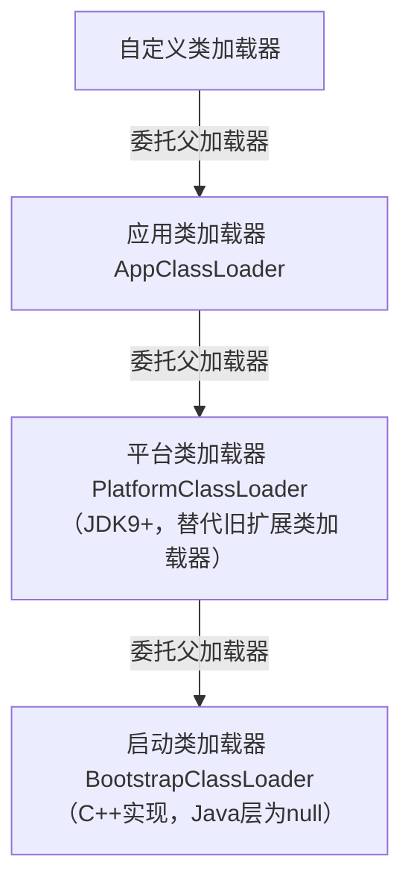

**加载器层次与职责**：

- **BootstrapClassLoader**：C++实现，加载JVM核心基础类库（java.base模块核心类，如Object、String），无Java对象实例，Java层面用null表示
- **PlatformClassLoader**：JDK9模块化之后新增，替代JDK8的Ext扩展类加载器，加载JDK平台相关类库
- **AppClassLoader**：系统类加载器，加载项目classpath、应用依赖jar包的类
- **Custom 自定义类加载器**：常用于热部署、类隔离、动态加载字节码

**双亲委派两大优势**：
1. 安全保障：核心基础类统一由Bootstrap加载，防止自定义同名核心类覆盖原生类，保障沙箱安全
2. 避免重复加载：同一个全类名的类只会被加载一次，保证类唯一性（类唯一性 = 全类名 + 类加载器）

> JDK8 Ext扩展类加载器在JDK9模块化后改为平台类加载器 PlatformClassLoader。
> 
> 默认实现：`loadClass()` 方法内实现双亲委派逻辑，先检查本加载器已加载缓存，向上委托父加载器；父加载全部失败后，调用 `findClass()` 由当前加载器读取字节码。
> 源码中`findClass`默认抛出ClassNotFoundException，自定义加载器一般重写findClass，**不推荐重写loadClass，避免破坏双亲委派**。

### 2.3 双亲委派的破坏

双亲委派只是推荐的设计模型，**不是JVM强制规范**。业务场景需要时可以打破，三种经典场景：

1. **JDBC SPI（线程上下文类加载器TCCL）**：`DriverManager`由Bootstrap加载，但数据库驱动实现类放在应用classpath，Bootstrap无法加载。通过**线程上下文类加载器TCCL**反向委派，父加载器调用子加载器加载驱动类。
2. **Tomcat Web容器**：每个Web应用独立WebappClassLoader，**优先加载当前war包内类，加载失败才委托父加载器**。实现不同web应用同名类隔离，支持单个应用热部署。
3. **OSGi、自定义模块化框架**：为实现模块版本隔离、模块动态安装卸载，采用更加复杂的委派模型。
> 双亲委派是默认安全机制；SPI、Web容器等场景主动破坏，核心目的解决「父加载器无法访问子加载器资源」、应用类版本隔离等问题。
> ⚠️ 破坏双亲委派存在风险：类唯一性失效，容易出现ClassCastException、静态变量多副本、安全风险。

### 2.4 业务落地场景

- 动态生成类（ASM、CGLIB、Groovy脚本）：运行时不断创建新Class，元空间持续增长
- 热部署场景：旧类加载器引用没有释放，旧类无法卸载，**类元数据泄漏，最终Metaspace OOM**
- SpringBoot 胖 jar：使用`LaunchedURLClassLoader`自定义类加载器，读取jar包内部BOOT-INF/classes、BOOT-INF/lib中的class，突破原生类加载器无法读取jar内部嵌套jar的限制
- 排查建议：
  1. JVM参数：`-XX:MaxMetaspaceSize`限制元空间上限，提前发现泄漏
  2. 诊断命令：`jcmd`、`jmap -clstats` 查看类加载统计
  3. MAT内存分析工具：分析ClassLoader引用链，定位无法卸载的类加载器泄漏

### 2.5 易混考点补充

1. **接口和类初始化差异**
   - Class：子类初始化，一定先触发父类初始化；
   - Interface：子接口初始化，**不会初始化父接口**；实现类初始化，不会初始化它实现的接口；接口没有静态代码块，接口static final常量在准备阶段直接赋值。
2. **永久代(PermGen) vs 元空间(Metaspace)**
   - 永久代(JDK7及之前)：位于JVM堆内，有固定大小上限，容易抛出`PermGen OOM`；仅Full GC才尝试类卸载，回收条件苛刻。
   - 元空间(JDK8+)：使用操作系统本地内存，默认不设上限（可手动配置`MaxMetaspaceSize`）；同样Full GC执行类卸载，内存扩容更灵活。
3. **类加载懒加载特性**
JVM采用懒加载，不会在程序启动一次性加载全部类，只有触发**主动使用**才走完加载到初始化流程，减少启动内存占用。
---

## 3. 运行时内存区域（核心重点）
> 一句话结论：内存分区**线程私有**（虚拟机栈、本地方法栈、程序计数器）、**线程共享**（堆、元空间）；**直接内存**是 JVM 规范之外的堆外区。90% 线上 OOM 问题，均可定位到具体分区。

### 3.1 内存分区总览（规范五区 + 堆外区）
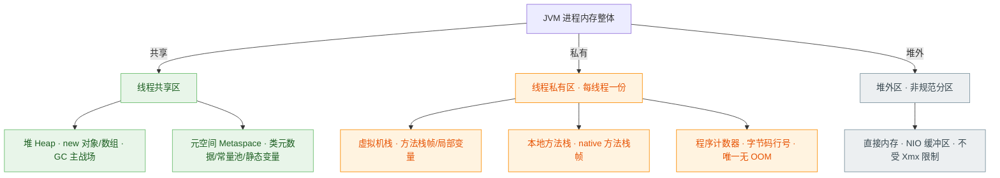

### 3.2 分区详细说明
| 内存区域 | 归属特性 | 存储内容 | 异常场景 |
| --- | --- | --- | --- |
| 堆 Heap | 线程共享，GC 主战场 | 所有 new 实例、数组、集合对象 | Java heap space OOM |
| 虚拟机栈 | 线程私有，随线程销毁 | 栈帧（局部变量表、操作数栈、动态链接、方法出口） | StackOverflowError、栈 OOM |
| 本地方法栈 | 线程私有，随线程销毁 | native 方法（C/C++）的栈帧 | StackOverflowError |
| 元空间 | 线程共享，JDK8+ 替代永久代 | 类结构、方法、常量、注解、动态生成类 | Metaspace OOM（类泄漏） |
| 程序计数器(PC寄存器) | 线程私有 | 当前线程执行的字节码行号 | 无（唯一无 OOM 区域） |
| 直接内存 | 堆外，非规范分区，不受 Xmx 限制 | NIO ByteBuffer、网络缓冲区 | Direct buffer memory OOM |

元空间中常量池就是类文件中的**符号表**，集中存放：
- 字面量，如字符串、整数；
- 符号引用，如类名、字段名、方法名、描述符。

>
>类文件里的常量池叫 **Class 文件常量池**。
>
>类加载后，常量池内容会进入 **运行时常量池**，逻辑上属于方法区。JDK 8 以后 HotSpot 用 **Metaspace** 实现方法区。
>
> **补充：String 字符串常量池**。JDK7 起字符串常量池从方法区移入堆：`intern()` 会把字符串复制进常量池并长期驻留，滥用是线上 Full GC / OOM 的隐性来源。元空间中的「运行时常量池」与堆中的「字符串常量池」是两个东西，面试常考区别。

### 3.3 堆分代模型
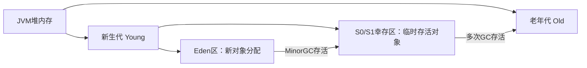
- **新生代**：对象朝生夕死，Minor GC 频繁、停顿短、效率高
- **老年代**：长期存活对象，回收频率低、开销大、易触发 Full GC
- **对象晋升**：新生代熬过多次 GC 后，迁移至老年代长期存储
- **大对象**：超过阈值的大对象直接进入老年代（`-XX:PretenureSizeThreshold`，仅 Serial/Parallel 生效；G1 下进入专门的大对象区 Humongous Region）>
> **修正说明**：G1 在逻辑上**仍然分代**（新生代/老年代），只是物理上划分为 Region 分区；ZGC 才默认不分代（JDK21 起提供分代模式）。"弱化分代"的说法不准确，应为"分区化"。

### 3.4 元空间
JDK 8 以后，HotSpot 用 **Metaspace（元空间）** 取代了永久代，用来实现 **方法区**。它主要存放**类级别的元数据**，而不是实例对象。

可以把 Metaspace 理解为：**JVM 存放“类长什么样、怎么用”的地方**。

##### 3.4.1 类结构

每个被加载的类，在 Metaspace 中都有一个对应的 **类元数据对象**。HotSpot 中常见的是：
- `InstanceKlass`：普通 Java 类；
- `InstanceMirrorKlass`：`java.lang.Class` 对象对应的类；
- `InstanceRefKlass`：引用类型；
- `ArrayKlass` / `ObjArrayKlass` / `TypeArrayKlass`：数组类；
- `InstanceClassLoaderKlass`：类加载器相关。

这些元数据描述的是一个类“是什么”，包括：
- 类名、父类、接口；
- 访问标志：`public`、`final`、`abstract` 等；
- 字段列表：名字、类型、偏移量、访问标志；
- 方法列表：名字、描述符、字节码入口、访问标志；
- 常量池；
- 注解；
- 内部类、外部类、嵌套关系；
- 类加载器引用；
- 初始化状态；
- vtable / itable：虚方法表、接口方法表；
- 静态字段的布局信息；
- 实例对象的大小、字段偏移；
- 是否已链接、是否已初始化。

类元数据本身不是 `java.lang.Class` 对象。  
`java.lang.Class` 对象在 **Java 堆** 中，它内部有一个指针指向 Metaspace 里的 `InstanceKlass`。

所以关系是：

```text
Java 堆中的 java.lang.Class 对象
        ↓ 指向
Metaspace 中的 InstanceKlass 类元数据
```

#### 3.4.2 方法

Metaspace 中和方法相关的内容主要有：

##### 方法元数据

每个方法对应一个 `Method` 对象，记录：

- 方法名；
- 描述符；
- 访问标志；
- 字节码起始地址；
- 字节码长度；
- 异常表；
- 局部变量表大小；
- 操作数栈大小；
- 是否是 native、abstract、static、final、synchronized；
- 方法上的注解；
- 参数注解；
- 默认值；
- 泛型签名；
- 方法在 vtable 中的索引。

##### 字节码

方法的字节码指令本身也存在 Metaspace 中。  
JVM 解释执行时，就是从这里读取字节码。

##### JIT 编译后的代码

JIT 把热点方法编译成机器码后，机器码通常放在：

- **Code Cache**；
- 不在 Metaspace。

但 Metaspace 中的 `Method` 会记录：

- 是否已被 JIT 编译；
- 对应的 `nmethod` 入口；
- 解释器入口；
- 适配器入口等。

所以可以理解为：

```text
方法元数据在 Metaspace
方法字节码在 Metaspace
JIT 机器码在 Code Cache
```

##### vtable 和 itable

- **vtable**：虚方法表，用于动态分派；
- **itable**：接口方法表，用于接口调用。

它们也是类元数据的一部分，存放在 Metaspace 中。

#### 3.4.3 常量

这里要区分几个概念：

##### 1）Class 文件常量池

编译后存在 `.class` 文件里，包括：

- 字面量：字符串、整数、浮点数；
- 符号引用：类名、字段名、方法名、描述符。

##### 2）运行时常量池

类加载后，Class 文件常量池的内容进入 **运行时常量池**，逻辑上属于方法区，HotSpot 8+ 中位于 Metaspace。

它包含：

- `CONSTANT_Class_info`：类符号引用；
- `CONSTANT_Fieldref_info`：字段符号引用；
- `CONSTANT_Methodref_info`：方法符号引用；
- `CONSTANT_InterfaceMethodref_info`：接口方法符号引用；
- `CONSTANT_String_info`：字符串字面量符号引用；
- `CONSTANT_Integer_info`、`CONSTANT_Float_info`、`CONSTANT_Long_info`、`CONSTANT_Double_info`；
- `CONSTANT_NameAndType_info`；
- `CONSTANT_Utf8_info`：UTF-8 字符串，存类名、方法名、描述符等。

注意：

- **字符串字面量的内容**，比如 `"hello"` 这个 `String` 对象，JDK 7 以后在 **Java 堆** 的字符串常量池中；
- 但 `CONSTANT_String_info` 这个符号引用、`CONSTANT_Utf8_info` 这些描述信息，在 **Metaspace 的运行时常量池** 中。

##### 3）静态变量

这里容易混：

- 按 JVM 规范，类变量逻辑上属于方法区；
- HotSpot 8+ 的实现中，静态字段通常放在 **Java 堆中的 `java.lang.Class` 对象** 里；
- Metaspace 中保存的是静态字段的**布局信息**，不是字段值本身。

所以：

```text
静态字段的值       → Java 堆中的 Class 对象
静态字段的元数据   → Metaspace
```

---

#### 3.4.4 注解

注解在 Metaspace 中的存在形式，取决于保留策略：

- `SOURCE`：编译后丢弃，不进 class 文件；
- `CLASS`：进 class 文件，但运行时 JVM 不保留；
- `RUNTIME`：进 class 文件，运行时保留，可通过反射读取。

对于 `RUNTIME` 注解，类加载后：

- 注解信息会保存在 Metaspace 的类元数据中；
- 反射调用 `getAnnotations()`、`getDeclaredAnnotations()` 时，JVM 从 Metaspace 读取；
- 注解的属性值，比如 `@MyAnno(name="abc", value=1)`，也会被保存；
- 如果注解属性是 `Class`、枚举、注解、数组，也会以相应形式保存。

注解可以出现在：

- 类上；
- 方法上；
- 字段上；
- 构造器上；
- 参数上；
- 类型参数上；
- 局部变量上，但局部变量注解通常只在 class 文件中，运行时不一定保留。

Metaspace 中保存注解，使得反射可以读取它们。

#### 3.4.5 动态生成类

动态生成类也占用 Metaspace。常见来源：

##### 1）JDK 动态代理

```java
Proxy.newProxyInstance(...)
```

运行时会生成类似：

```text
com.sun.proxy.$Proxy0
jdk.proxy1.$Proxy1
```

这些类在运行期被定义并加载，类元数据进入 Metaspace。

##### 2）CGLIB / ByteBuddy / ASM

Spring AOP、MyBatis、Hibernate 等常用字节码库生成子类或代理类，例如：

```text
Foo$$EnhancerByCGLIB$$12345678
```

这些类也会加载进 Metaspace。

##### 3）Lambda

Lambda 表达式在运行时会通过 `LambdaMetafactory` 生成调用点，可能生成：

- 隐藏类；
- 或动态代理类。

这些隐藏类的元数据也在 Metaspace。

##### 4）反射、脚本引擎、JSP

- JSP 编译成 Servlet 类；
- Groovy、Kotlin 脚本动态编译；
- OSGi、热部署框架反复加载类。

这些都会不断产生新的类元数据。

##### 5）频繁生成类的风险

如果动态生成类不断增多，且类加载器无法被回收，就会导致：

```text
Metaspace 持续增长 → Metaspace OOM
```

常见错误：

```text
java.lang.OutOfMemoryError: Metaspace
```

常见原因：

- 热部署反复加载同一个类；
- 动态代理类无限生成；
- 类加载器泄漏，导致类元数据无法卸载。

相关参数：

```text
-XX:MetaspaceSize
-XX:MaxMetaspaceSize
-XX:+CMSClassUnloadingEnabled
-XX:+ClassUnloadingWithConcurrentMark
```

Metaspace 默认不限制最大大小，受本地内存限制。  
如果设置了 `-XX:MaxMetaspaceSize`，超过就会 OOM。

#### 3.4.6 Metaspace 中还有什么？

除了上面五类，还有：

- **类加载器元数据**：每个类加载器在 Metaspace 中有对应结构；
- **常量池缓存**：解析后的直接引用；
- **符号表**：`SymbolTable`，存放 UTF-8 符号，如类名、方法名；
- **字符串表**：`StringTable`，但字符串对象本身在堆中；
- **注解缓存**；
- **反射数据**：`Reflection` 相关元数据；
- **方法计数器**：用于 JIT 热点判断；
- **异常表**；
- **LineNumberTable、LocalVariableTable** 等调试信息，视编译参数而定；
- **泛型签名信息**；
- **默认方法、桥接方法**；
- **模块信息**：JDK 9+ 的 `Module` 元数据。

#### 3.4.7 一张图串起来

```text
Metaspace
├── 类结构
│   ├── InstanceKlass
│   ├── 父类/接口
│   ├── 字段布局
│   ├── vtable / itable
│   └── 类加载器引用
├── 方法
│   ├── Method 元数据
│   ├── 字节码
│   ├── 异常表
│   ├── 局部变量表
│   └── JIT 入口信息
├── 常量
│   ├── 运行时常量池
│   ├── 符号引用
│   ├── UTF-8 符号
│   └── 解析后的直接引用
├── 注解
│   ├── 类注解
│   ├── 方法注解
│   ├── 字段注解
│   └── 参数注解
├── 动态生成类
│   ├── JDK 代理
│   ├── CGLIB / ByteBuddy
│   ├── Lambda 隐藏类
│   └── JSP / 脚本类
└── 其他
    ├── SymbolTable
    ├── 反射数据
    ├── 模块信息
    └── 调试信息
```

#### 3.4.8 容易混淆的点

| 内容 | 位置 |
|---|---|
| 实例对象 | Java 堆 |
| 字符串字面量对象 | Java 堆字符串常量池 |
| 静态字段的值 | Java 堆中的 Class 对象 |
| 静态字段布局信息 | Metaspace |
| 类元数据 | Metaspace |
| 方法字节码 | Metaspace |
| JIT 机器码 | Code Cache |
| 运行时常量池 | Metaspace |
| 注解 | Metaspace |
| 动态生成类元数据 | Metaspace |
| `java.lang.Class` 对象 | Java 堆 |

> Metaspace 存的是**类级别、方法级别、常量级别、注解级别、动态类级别的元数据**。  
> 它描述“类是什么、方法怎么执行、常量怎么解析、注解是什么、动态类长什么样”。  
> 实例对象、字符串内容、静态字段值通常在 Java 堆；JIT 机器码在 Code Cache。

### 3.5 虚拟机栈调用机制
方法嵌套调用对应栈帧入栈/出栈，和前端调用栈逻辑一致，核心差异：**Java 每条线程独立栈，线程越多，栈内存总占用越高**（可通过 `-Xss` 调优单栈大小）。递归无边界、方法嵌套过深 → `StackOverflowError`（栈溢出而非堆溢出）。
>
> 一句话：**虚拟机栈是"栈帧的容器"，一个方法对应一个栈帧（Frame）**。调用方法 → 压栈；方法返回或抛异常 → 弹栈。栈内存由系统自动回收，**不需要 GC 参与**。

#### 3.5.1 栈帧内部结构
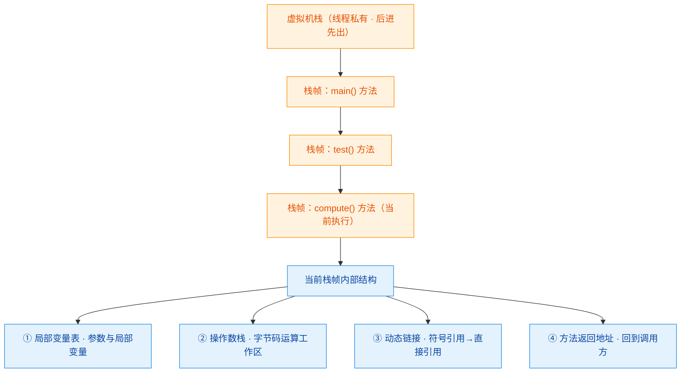
| 组成部分 | 作用 | 关键点 |
| --- | --- | --- |
| **① 局部变量表** | 存方法参数 + 方法内局部变量 | 数组结构，slot 为最小单位：byte/short/char/int/float 占 1 槽，long/double 占 2 槽；`reference` 只存堆中对象的**地址**；编译期定容量，运行期不扩容 |
| **② 操作数栈** | 字节码指令的临时运算工作区 | 先进后出；JVM 不直接操作寄存器，运算靠压栈/出栈完成；编译期定最大深度 |
| **③ 动态链接** | 把 class 文件里的**符号引用**解析为**直接引用**（内存地址） | class 文件里只存字符串形式的方法/字段引用，运行时才找到真实地址 |
| **④ 方法返回地址** | 记录执行完后回到调用方的位置 | 正常 return 指令 → 回调用处；抛异常 → 跳异常处理逻辑 |
>
> 可选附加：部分实现还带**附加信息**（异常表、锁记录等），用于异常捕获与 synchronized 的锁优化。
---

## 4. 对象的一生（主线）
> 一句话结论：**对象的一生 = 创建 → 并发分配（CAS / TLAB）→ 逃逸分析优化 → 访问定位 → 晋升 → 回收**。这条主线把 §3 内存布局与 §5 GC 串起来，理解它比记住任何单点都重要。

### 4.1 对象创建流程

- **类加载检查**：先确认类已加载（§2），否则触发类加载。
- **分配内存**：Eden 连续空间用**指针碰撞**；CMS 等碎片化堆用**空闲列表**。
- **并发安全处理**：多线程同时分配内存时，HotSpot 提供 CAS + 失败重试 与 TLAB 两条对策（详见 §4.2）。
- **内存置零**：保证实例字段有默认零值。若使用 TLAB，零值初始化可提前到 TLAB 分配时顺便完成，避免对象创建主路径上的重复写操作。
- **对象头**：写入 Mark Word、类型指针（见 §4.4）。
- **构造方法**：执行 `<init>`，完成业务初始化。字节码层面需要 `new + dup + invokespecial` 三条指令才算完成一次完整构造。

#### 4.1.1 new 指令

因为 `new` 指令的操作数**不是直接指向某个类的内存地址**，而是**当前类的常量池索引**。JVM 执行 `new` 时，必须先通过这个索引去**运行时常量池**里找到对应的类符号引用，然后才能解析、检查、加载、初始化目标类。

所以“检查常量池中能否定位到对应的类”，准确说是：

> 
> `new` 指令带一个常量池索引 → 根据索引在当前类的运行时常量池中找到 `CONSTANT_Class_info` → 解析这个符号引用 → 检查对应的类是否已加载/链接/初始化，并确认它是否可实例化。

示例代码：
```java
Foo f = new Foo();
```

编译后的字节码大致是：
```text
new           #2      // 操作数 #2 是常量池索引，指向 Foo 的类符号引用
dup
invokespecial #3      // 调用 <init>，即 Foo 的构造方法
astore_1
```

常量池内容示例：
```text
#2 = Class              #4      // CONSTANT_Class_info，指向 #4
#3 = Methodref          #2.#5   // Foo.<init>:()V
#4 = Utf8               Foo
#5 = NameAndType        #6:#7   // <init>:()V
#6 = Utf8               <init>
#7 = Utf8               ()V
```

- new 指令执行流程（Mermaid流程图）
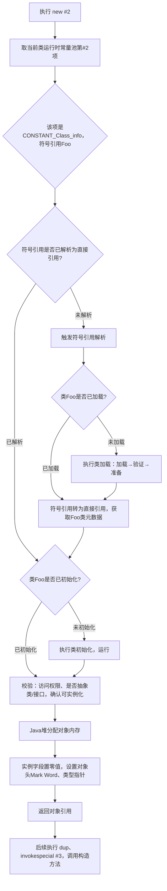

> 
> 注意：`new` 指令本身只负责“创建对象并返回引用”，**不负责调用构造方法**。构造方法调用由后面的 `invokespecial` 完成。

所以“检查常量池中能否定位到对应的类”，本质是：
> 
> 通过常量池索引找到类符号引用，再解析这个符号引用，检查对应类是否已经可用、可实例化。只有解析并确保类初始化完成后，JVM 才会真正为对象分配内存；构造方法则由后续 `invokespecial` 调用。


### 4.2 TLAB（线程本地分配缓冲）与并发分配策略

多线程同时申请内存，本质上是对共享指针的竞态写入。HotSpot 提供两条对策：

| 策略 | 做法 | 特点 |
| --- | --- | --- |
| **CAS + 失败重试** | 通过原子操作保证指针更新的正确性 | 实现简单，但锁竞争严重时开销大 |
| **TLAB（Thread Local Allocation Buffer）** | 每个线程在 Eden 区预先分配一小块私有缓冲区（默认占 Eden 区 1%），线程内分配无需同步，仅当 TLAB 用尽、需要申请新缓冲区时才通过 CAS 加锁 | 把低频的批量申请做成同步操作，把高频的逐次分配变成线程私有的无锁操作 |

- 默认开启（`-XX:+UseTLAB`），`-XX:TLABSize` 可调。
- **TLAB 用尽的退化路径**：大对象无法在 TLAB 内分配时，退化为**加锁在 Eden 公共区分配**；超大对象（超过 `-XX:PretenureSizeThreshold` 阈值，仅 Serial/ParNew 生效）直接进入老年代；G1 下大对象进入专门的 **Humongous Region**（大于 Region 一半的对象）。
- 一句话：**TLAB 是"分配快路径"，让 new 在多线程下几乎无锁。**

### 4.3 逃逸分析（JIT 的隐藏优化）
JIT 在编译期判断对象**是否逃出方法/线程**：

#### 对象逃逸的判定
对象在方法/线程外被引用。满足下面任意一条就是**对象逃逸**，只能分配在堆上。

| 逃逸场景 | 说明 | 逃逸判定 |
| --- | --- | --- |
| 静态变量 | 赋给 static 字段，全局可见 | **必然线程逃逸** |
| 成员变量 | 赋给堆上已存在对象的字段，或传给 Thread | **通常线程逃逸**；若宿主对象本身未逃逸，则不一定 |
| 函数参数 | 把 this 或内部对象传给外部方法 | **取决于被调方法**：保存引用→逃逸；内联后未保存→不逃逸 |
| 函数返回值 | 直接 return 对象引用 | **方法逃逸** |
| 内部对象持有外部引用 | 内部对象的字段指向外部对象/参数/返回值 | **随内部对象**：内部对象逃逸→外部对象逃逸；内部对象不逃逸→外部对象也不逃逸 |

> 误区纠正：HotSpot **并没有真正实现"栈上分配"**。我们常说的栈上分配效果来自**标量替换**：对象被拆解为独立基本类型变量，存放在栈帧或寄存器。

#### 逃逸程度与可做的优化

| 逃逸程度 | 含义 | 可做的优化 |
| --- | --- | --- |
| **不逃逸** | 对象只在方法内使用，外部无法获得引用 | **标量替换**（Scalar Replacement）、**锁消除**（Lock Elision）、**消除堆分配** |
| **方法逃逸** | 作为返回值/参数传出方法，但未跨线程 | **锁消除**（锁对象仅本线程可见时）、**部分标量替换**（Graal） |
| **线程逃逸** | 被其他线程访问 | 必须堆分配；**仅当共享可变状态被并发读写时才需同步** |

> **最好的 GC 是不产生垃圾**。逃逸分析默认开启（`-XX:+DoEscapeAnalysis`），只有被 C2 编译的热点方法才生效；JDK17+ 标量替换默认关闭，需要显式开启 `-XX:+EliminateAllocations`。

#### 部分逃逸分析（Partial Escape Analysis）
传统逃逸分析是"全有或全无"：只要任意分支逃逸，整段代码无法优化。Graal 的部分逃逸分析，仅在逃逸分支物化对象到堆，未逃逸分支继续标量替换，可降低分配量最高 58.5%。

#### 优化失败边界
- 方法未内联：编译器无法判断引用是否保存，保守判定逃逸
- 对象过大：>128 字节通常放弃标量替换，防止栈溢出
- 动态结构：泛型集合、数组等结构，标量替换失效
- 冷代码不生效：只有热点方法（默认调用10000次）触发C2编译

### 4.4 对象头与指针压缩

**对象内存布局**：
```
| 对象头 (Header) | 实例数据 (Instance Data) | 对齐填充 (Padding) |
```

**对象头 = Mark Word + Klass Pointer（+ 数组长度，仅数组对象）**：

| 部分 | 位数（64 位 JVM） | 内容 |
| --- | --- | --- |
| **Mark Word** | 8 字节 | hashCode、GC 分代年龄、锁状态标志、偏向线程 ID、偏向时间戳 |
| **Klass Pointer** | 4 字节（开启指针压缩） / 8 字节 | 指向元空间的类元数据 |
| **数组长度** | 4 字节（仅数组对象） | 数组元素个数 |

**实例数据的字段排布**：HotSpot 按字段宽度降序重排，父类声明的字段块排在前面，同宽度字段之间保留源码顺序。重排的目的是消除字段之间的对齐空隙，让对象尺寸尽量紧凑。

**JDK 17 压缩指针开启下的实测大小**：

| 对象类型 | 实测大小 | 构成拆解 |
| --- | --- | --- |
| 裸 Object | 16 字节 | 对象头 8 + 类型指针 4 + 对齐填充 4 |
| 含 int 字段的对象 | 16 字节 | 头 12 + 实例数据 4 |
| 含 long 字段的对象 | 24 字节 | 头 12 + 对齐 4 + 实例数据 8 |
| String 壳对象 | 24 字节 | —— |
| Integer 装箱对象 | 16 字节 | —— |

> 实测数据揭示两条工程规律：其一，对象头是固定税，裸 Object 仍占 16 字节，实例部分为零；其二，装箱是隐性放大器，int 在数组里只占 4 字节，装箱为 Integer 后达 16 字节，内存开销膨胀至 4 倍——集合选型时 `List<Integer>` 与 `int[]` 的差距正是由此而来。

**Mark Word 在不同锁状态下的复用**

| 锁状态 | 存储内容 |
| --- | --- |
| 无锁 | hashCode + 分代年龄 + 锁标志 `01` |
| 偏向锁 | 偏向线程 ID + Epoch + 分代年龄 + `01` |
| 轻量级锁 | 指向栈中锁记录的指针 + `00` |
| 重量级锁 | 指向 Monitor 对象的指针 + `10` |
| GC 标记 | 空 + `11` |

**指针压缩（CompressedOops）**：
- 64位JVM默认开启 `-XX:+UseCompressedOops`，64位指针压缩为32位，最大寻址32G堆
- **堆超过32G，指针压缩失效**，对象头、引用占用翻倍，内存利用率下降
- `-XX:+UseCompressedClassPointers` 压缩类指针，Compressed Class Space 默认约1GB，类泄漏容易先撑爆这块空间。

### 4.5 对象访问定位

Java 程序通过栈上的 reference 操作堆上对象，reference 在 HotSpot 中是一个返回类型为 `reference` 的本地指针。主流访问方式有两种：

| 方式 | 原理 | 优点 | 缺点 |
| --- | --- | --- | --- |
| **句柄访问** | 堆中划分句柄池，reference 存储句柄地址，句柄包含实例数据和类型数据的具体地址 | 对象移动（GC 整理）时 reference 不变，仅修改句柄中的实例指针 | 多一次间接指针定位开销 |
| **直接指针（HotSpot 采用）** | reference 直接存储对象地址，对象头中的类型指针指向方法区 | 节省一次指针定位开销，访问速度更快 | 对象移动时 reference 本身需要修改 |

> HotSpot 选择直接指针的取舍逻辑：在绝大多数应用场景中，对象访问频率远高于 GC 移动对象的频率，用对象移动时修改 reference 的一次性代价，换取每次访问节省一轮指针定位的持续性收益。

### 4.6 晋升与回收

对象进入老年代共有五条路径，理解这五条路径是排查"为什么对象提前进入老年代"与"为什么 Full GC 意外出现"的基础：

| 晋升路径 | 规则说明 | 相关参数 |
| --- | --- | --- |
| **年龄阈值晋升** | 对象每经历一次 Minor GC 存活，年龄加 1，达到阈值强制晋升老年代 | `-XX:MaxTenuringThreshold`，默认 15，取值范围 1~15 |
| **动态年龄判断** | 在 Survivor 中按年龄从小到大累加对象大小，累加值超过 Survivor 容量的 50% 时，大于等于该年龄的对象直接晋升。**优先级高于固定年龄阈值** | `-XX:TargetSurvivorRatio`，默认 50% |
| **大对象直接进入老年代** | 超过阈值的对象跳过新生代直接在老年代分配，避免在 Eden 与 Survivor 之间的复制开销 | `-XX:PretenureSizeThreshold`，仅对 Serial、ParNew 收集器有效，在 G1 下静默无效 |
| **Survivor 空间不足** | 存活对象无法复制进 To Survivor 时，直接提前晋升老年代 | 晋升不受年龄限制 |
| **空间分配担保** | Minor GC 前检查老年代可用空间是否大于新生代对象总大小，或大于历次晋升的平均大小；若不足，直接触发 Full GC | JDK 6u24 之后 `-XX:HandlePromotionFailure` 参数已失效 |

> 动态年龄判断的优先级设计值得特别注意：虚拟机不看 `-XX:MaxTenuringThreshold` 的固定值，而是在每次 Minor GC 后统计 Survivor 内同龄对象的空间占用，一旦某年龄及以下对象累计超过 Survivor 容量的一半，就允许该年龄及以上对象提前晋升。这也解释了为什么在部分负载下对象年龄未到 15 就已进入老年代。

对象晋升到老年代后，进入 §5 的 GC 回收流程——Minor GC 回收新生代，Major GC 回收老年代，Full GC 回收全堆。

---

## 5. GC 垃圾回收机制（核心）
> 一句话结论：JVM 通过**可达性分析**判定垃圾，用**三色标记**实现并发标记，自动回收堆内存无效对象；所有 GC 均存在 STW 停顿，核心优化目标是「降低停顿、减少 GC 频率」。

### 5.1 垃圾判定：可达性分析
摒弃 Python 的引用计数（无法解决循环引用），JVM 采用根搜索算法：从 GC Roots 出发，遍历可达对象为存活对象，不可达即为可回收垃圾。
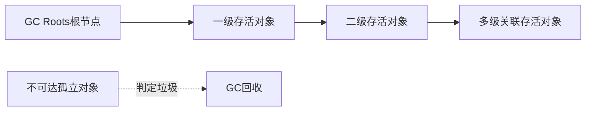
**常见 GC Roots**：线程栈局部变量、静态字段/常量引用、本地方法 JNI 引用、加载的 Class 对象、系统类引用。

### 5.2 三色标记算法（并发标记的核心）
**三种颜色**：
- **白色**：未被访问（标记结束仍为白 → 垃圾）
- **灰色**：自己已访问，但**引用还没扫描完**
- **黑色**：自己和所有引用都已扫描完（存活）
**标记过程**：GC Roots 置灰 → 取灰对象扫描，把它引用的白对象置灰，自己变黑 → 重复直到无灰对象。
**并发漏标问题**：用户线程并发修改引用，会出现存活对象被误标记为垃圾。
两个条件同时满足就会漏标：
1. 黑色对象新增指向白色对象的引用
2. 灰色对象到白色对象的原有引用被删除
**两种解决方案**
| 方案 | 做法 | 使用方 |
| --- | --- | --- |
| **增量更新（Incremental Update）** | 记录黑→白新增引用，重新标记阶段回溯扫描 | **CMS** |
| **原始快照（SATB）** | 记录灰→白删除的旧引用，按标记开始时快照判定存活 | **G1、Shenandoah** |
>
> 一句话：**增量更新管新加的引用，SATB管删掉的引用，防止存活对象误回收**。

### 5.3 三大 GC 基础算法
| 算法 | 做法 | 优点 | 缺点 | 使用方 |
| --- | --- | --- | --- | --- |
| **标记-清除** | 标记存活 → 直接清垃圾 | 实现简单 | **内存碎片**、效率随对象数下降 | CMS |
| **标记-复制** | 存活对象复制到另一半，整块清空 | 无碎片、分配快 | **浪费一半空间**、复制成本 | 新生代（Eden+S0/S1） |
| **标记-整理** | 标记存活 → 全部向一端移动 → 清边界外 | 无碎片、不浪费空间 | 移动成本高、STW 长 | 老年代（Serial Old、Parallel Old） |
>
> 分代本质：新生代存活少，复制成本低；老年代存活多，复制代价高，用标记清除/整理。

### 5.4 四大引用类型
| 引用类型 | 特性 | 回收规则 | 业务场景 |
| --- | --- | --- | --- |
| 强引用 | 默认引用 | 永不回收，直至 OOM | 常规业务对象 |
| 软引用 | 内存敏感 | 内存不足时回收 | 图片缓存、临时缓存 |
| 弱引用 | 生命周期最短 | 只被弱引用可达时下次 GC 必回收 | 防内存泄漏、缓存兜底 |
| 虚引用 | 无实际引用作用 | 对象回收后收到入队通知 | 堆外内存监控 |
>
> 软/弱引用搭配 `ReferenceQueue`：引用对象被回收时引用入队，业务清理关联资源（DirectBuffer）。

### 5.5 主流 GC 收集器演化
**演化主线**：
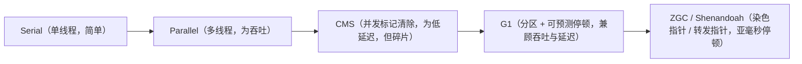
| 收集器 | 核心特点 | 适用场景 | 版本状态 |
| --- | --- | --- | --- |
| Serial | 单线程回收、简单高效、STW 长 | 客户端、小内存应用 | 老旧、基本淘汰 |
| Parallel | 多线程、高吞吐量、不关注延迟 | 后台批量任务、离线服务 | **JDK8 默认** |
| CMS | 并发低延迟、内存碎片多 | 早期低延迟业务 | **JDK9 废弃、JDK14 移除** |
| **G1** | 分区回收、可控停顿、吞吐延迟兼顾 | 线上大堆、通用 Web 服务 | **JDK9+ 默认** |
| ZGC | 超低 STW、超大堆适配 | 延迟敏感、超大集群 | JDK11 实验、**JDK15 转正**；默认不分代，JDK21+ 支持分代 |
| Shenandoah | 超低延迟，与 ZGC 并列 | 低延迟场景 | JDK12 引入，实验居多 |
**CMS 四阶段**
1. **Initial Mark**（STW）：标记 GC Roots 直接关联对象，快
2. **Concurrent Mark**：并发遍历，慢
3. **Remark**（STW）：修正并发期间的引用变化（增量更新）
4. **Concurrent Sweep**：并发清除
**G1 三种 GC**
- **Young GC**：只回收新生代 Region，STW可控
- **Mixed GC**：回收新生代 + 部分老年代Region（G1主力）
- **Full GC**：单线程标记整理，业务尽量避免
**G1 内部机制**
- 堆划分为多个 Region（默认约2048个，大小1~32MB）
- **RSet（记忆集）**：记录跨Region引用，避免全堆扫描
- 停顿预测模型：`-XX:MaxGCPauseMillis` 控制目标停顿
- Mixed GC触发阈值：`-XX:InitiatingHeapOccupancyPercent` 默认45%
- **Humongous Region**：存放大于Region一半的大对象
**卡表与记忆集**
- **卡表 Card Table**：老年代划分为固定卡页，存在跨代引用标记脏卡
- **RSet**：G1每个Region维护，记录谁引用了当前Region，用于Mixed GC快速定位跨Region引用
**ZGC**：染色指针（标记信息存入对象指针）+读屏障，并发标记整理，STW极短。

### 5.6 GC 触发与 OOM 逻辑
- **Minor GC**：Eden 区无法分配新对象触发，频率高、速度快
- **Full GC**：老年代不足、晋升担保失败、手动`System.gc()`触发，开销极大；G1可用`-XX:+ExplicitGCInvokesConcurrent`转为并发GC
- **OOM**：多次GC回收后，堆/元空间/直接内存仍无足够空间分配对象。

### 5.7 SafePoint 安全点
> GC STW前，所有线程必须跑到安全点才能暂停。安全点位置：方法调用、循环回边、异常跳转。长时间无安全点的循环会造成GC等待，日志表现为 safepoint 耗时过高。排查STW问题重点关注。
---

## 6. 执行引擎
💡 一句话结论：**执行引擎是把字节码真正"跑起来"的发动机**：解释器保证启动快，JIT 编译器让热点代码越跑越快，GC 在后台回收堆垃圾。HotSpot 默认 `-Xmixed` 混合模式——启动期用解释器、运行期逐步交给 JIT，兼顾启动速度与峰值性能。
>
> 与全文的关系：§1 讲字节码长什么样，本章讲字节码如何被执行；§4「对象的一生」里提到的逃逸分析、标量替换，正是 JIT 在编译期做的优化；GC 详见 §5。

### 6.1 执行引擎整体架构
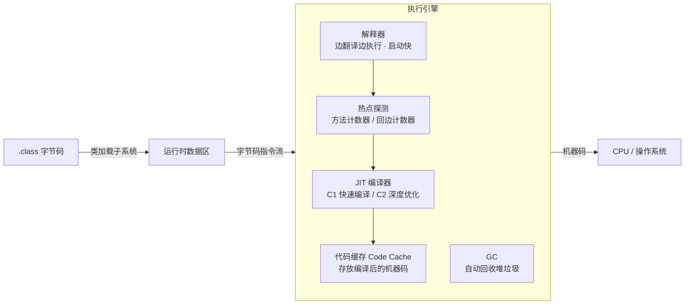
| 组成部分 | 职责 | 一句话理解 |
| --- | --- | --- |
| **解释器** | 逐条把字节码翻译成机器码执行 | "实时翻译"，零预热、启动快 |
| **热点探测** | 统计方法调用次数、循环回边次数 | 决定"谁值得被编译" |
| **JIT 编译器** | 把热点字节码编译为本地机器码 | "同声传译"，越跑越快 |
| **代码缓存** | 存放 JIT 编译出的机器码 | 非堆内存，有容量上限（默认约 240MB） |
| **GC** | 自动回收堆中的垃圾对象 | 详见 §5 |

### 6.2 解释器：为什么"慢"
- **执行方式**：每遇到一条字节码指令，就翻译成对应的机器码指令再执行，类似"实时翻译"
- **优点**：零预热、启动快、内存占用小；不依赖特定平台，是"一次编译、到处运行"的基础
- **缺点**：每次执行都要重复翻译 + 指令调度，性能远低于编译后的本地代码
- **HotSpot 的优化**：使用**模板解释器**——为常用指令预先生成机器码模板，执行时直接套模板，比早期"逐条查表翻译"的解释器快得多
- **与 JIT 的分工**：程序刚启动时全部解释执行（启动快）；热点升温后 JIT 介入编译，解释器只兜底非热点代码
- **三种模式**：纯解释 `-Xint`（调试用）、纯编译 `-Xcomp`（忽略预热，易因激进编译反而变慢）、混合 `-Xmixed`（**默认**）

### 6.3 热点探测（Hot Spot Detection）
HotSpot 名字的由来：**虚拟机边运行边统计"哪里热"，只把热点代码交给 JIT 编译**。
**两类计数器**：
| 计数器 | 统计对象 | 触发 |
| --- | --- | --- |
| **方法调用计数器** | 方法被调用的次数 | 达到阈值 → 方法级编译 |
| **回边计数器** | 循环"回边"执行的次数（循环末尾跳回开头） | 达到阈值 → 触发 OSR（§6.6） |
**阈值与衰减**：
- 传统模式下 `-XX:CompileThreshold`：Client 默认 **1500** 次、Server 默认 **10000** 次
- 开启分层编译（JDK8+ 默认）后由多参数动态计算：如 `Tier3CompileThreshold=2000`、`Tier4CompileThreshold=10000`、`Tier4MinInvocationThreshold=600`
- **热度衰减** `-XX:CounterHalfLifeTime`：方法超过一定时间（默认约 30 分钟）未被再次调用，计数减半，防止"历史热点"长期霸占编译资源
> ⚠️ **这就是压测必须预热的原因**：刚启动的方法还没达到编译阈值，全部在解释执行，性能数据严重失真。

### 6.4 JIT 编译器：C1 / C2 与分层编译
| 编译器 | 特点 | 适用阶段 |
| --- | --- | --- |
| **C1（Client）** | 编译快、优化浅（内联、去虚化等基础优化） | 启动期快速提升性能 |
| **C2（Server）** | 编译慢、优化深（逃逸分析、循环优化等） | 长期运行的峰值性能 |
**分层编译（Tiered Compilation）**：JDK7 引入、**JDK8 默认开启**，综合 C1 启动快与 C2 峰值高的优势，共 5 层：
| 层级 | 说明 |
| --- | --- |
| **0** | 解释执行，开启 Profiling（收集运行数据） |
| **1** | C1 简单编译（无 Profiling），用于确定不需要监控的代码 |
| **2** | 受限的 C1 编译 |
| **3** | 完整 C1 编译 + Profiling，**大多数方法首次编译落在这层** |
| **4** | C2 深度优化编译，最终形态 |
- **典型升级路径**：0（解释）→ 3（C1 + Profiling）→ 4（C2）；C1 采集的 Profile 数据正是 C2 深度优化的依据
- 常用参数：`-XX:+TieredCompilation`（开关，JDK8+ 默认开启）、`-XX:TieredStopAtLevel=4`（限制最高层级）
- 日常开发无需手动选择 `-client / -server`，JDK8+ 服务端默认分层编译

### 6.5 JIT 核心优化手段
| 优化 | 做法 | 效果 | 关键参数/说明 |
| --- | --- | --- | --- |
| **方法内联** | 把被调方法体直接展开到调用处 | 消除方法调用开销，是其他优化的前提 | 非热点 `MaxInlineSize=35` 字节、热点 `FreqInlineSize=325`、嵌套深度 `MaxInlineLevel=9` |
| **逃逸分析** | 判断对象是否逃出方法/线程 | 决定能否标量替换、锁消除 | 详见 §4.3；仅 C2 热点方法生效 |
| **标量替换** | 把对象拆成基本类型变量放栈/寄存器 | 消除堆分配 | "栈上分配"的真相：HotSpot 并没有真正实现栈上分配 |
| **锁消除 / 锁粗化** | 移除无竞争的锁、合并相邻加锁 | 减少锁开销 | 逃逸分析发现锁对象不逃逸时可消除 |
| **循环优化** | 循环展开、循环无关代码外提、循环剥离 | 减少循环分支与重复计算 | `LoopMaxUnroll` 默认 16 |
| **空值检查消除** | 流程可推断不可能 NPE 时删掉检查 | 减少冗余判断 | 依赖 Profile 与流程分析 |
| **常量折叠 / 死代码消除** | 编译期算好常量、删除永不执行的分支 | 减少运行期计算 | — |
| **去虚化（CHA）** | 借助类层次分析，把虚方法调用变成直接调用 | 配合内联提升多态场景性能 | 单态/双态/多态分派下收益不同 |
> 一句话：**JIT 优化 = "用编译期的分析，换运行期的速度"；分析的输入，正是 §6.3 分层编译中 Profiling 采集的运行数据。**

### 6.6 OSR 栈上替换
- **问题场景**：热点不是"方法"而是方法里的**一个长循环**（如 while(true) 服务循环）。普通 JIT 要等方法返回后才能替换，而长循环根本不会返回
- **OSR（On-Stack Replacement）**：循环还在执行中，直接把正在解释执行的循环体**无缝切换到编译后的机器码**，不必等方法结束
- **触发**：回边计数器达到阈值（结合 `-XX:OnStackReplacePercentage` 等参数计算）
- **意义**：让长跑循环也能享受 JIT 加速；也解释了"服务刚启动时 QPS 低、预热后上来"的现象——热点循环正从解释执行切换到编译执行

### 6.7 代码缓存 Code Cache
- **是什么**：存放 JIT 编译产物（本地机器码）的**非堆内存**区域
- **默认大小**：开启分层编译约 **240MB**，关闭分层编译约 **48MB**；用 `-XX:ReservedCodeCacheSize` 调整
- **JDK9+ 分段管理**：代码缓存拆分为非方法代码（Non-method）、profiled 代码、非 profiled 代码三段，避免互相挤占
- ⚠️ **CodeCache 打满的后果**：无法再编译新热点 → 退化为解释执行 → CPU 飙高、吞吐骤降，日志出现 `CodeCache is full` 警告
- **常见诱因**：动态生成类过多（CGLIB 代理、反射、Groovy 脚本）反复触发编译；分层编译配合过小的 CodeCache
- **观察命令**：
```bash
jcmd <pid> Compiler.codecache     # 查看代码缓存使用情况
java -XX:+PrintCodeCache ...      # 启动时打印 codecache 摘要
```

### 6.8 观察 JIT：实用命令与工具
```bash
java -XX:+PrintCompilation ...     # 打印每次 JIT 编译事件（方法、层级、耗时）
java -XX:+UnlockDiagnosticVMOptions -XX:+PrintInlining ...  # 打印内联决策，看"为什么没内联"
jcmd <pid> Compiler.queue          # 查看编译队列与待编译任务
```
- **工具**：JITWatch（可视化分析编译日志）、JFR（录制 Compilation 事件）、Arthas（在线反汇编）
> 排查"接口为什么越来越快 / 某段代码怎么没被优化"时，先确认是不是 JIT 预热或 CodeCache 问题，再查业务代码。
> **常见误区**：① 把"栈上分配"当 HotSpot 真实特性（实为标量替换）；② 认为 C2 一定比 C1 好（C1 带 Profiling 数据，场景不同各有优劣）；③ 以为 CodeCache 只是"缓存"无所谓——**满了会退化为解释执行，性能骤降**。
---

## 7. JMM 内存模型（并发基础）
💡 一句话结论：JMM 不是内存分区，而是**多线程读写共享变量的规范**；核心是 happens-before + 内存屏障，定义 volatile / synchronized 的语义。
>
> §3 讲数据存放位置；JMM 讲多线程读写共享变量的可见性、有序性、原子性规则。

### 7.1 为什么需要 JMM
现代CPU缓存、编译器重排、CPU乱序执行，多线程共享变量会出现三类问题：
- **可见性**：线程A修改变量，线程B看不到
- **有序性**：代码执行顺序被编译器/CPU重排
- **原子性**：`i++` 不是原子操作
JMM屏蔽底层硬件差异，统一多线程内存读写规范。

### 7.2 主内存与工作内存
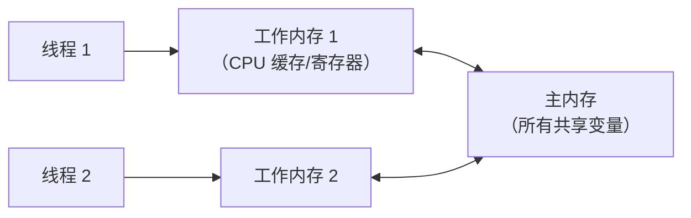
- 共享变量存**主内存**
- 每个线程有**工作内存**（抽象概念，对应CPU缓存、寄存器）
- 线程读写：主内存读到工作内存 → 修改 → 写回主内存
- **可见性根源：修改写回不及时**

### 7.3 happens-before 规则
**定义**：A happens-before B，代表A操作结果对B可见，不代表物理时间一定先执行。
**核心规则**
| 规则 | 含义 |
| --- | --- |
| **程序顺序** | 同一线程内，前面操作hb后面操作 |
| **监视器锁** | 解锁 hb 后续对同一锁的加锁 |
| **volatile** | volatile写 hb 后续对该变量读 |
| **线程启动** | `Thread.start()` hb 新线程所有操作 |
| **线程终止** | 线程所有操作 hb `join()` 返回 |
| **传递性** | A hb B，B hb C → A hb C |

### 7.4 内存屏障
内存屏障禁止指令重排、强制缓存刷新。4种屏障：
| 屏障 | 作用 |
| --- | --- |
| **LoadLoad** | 禁止读读重排 |
| **StoreStore** | 禁止写写重排 |
| **LoadStore** | 禁止读写重排 |
| **StoreLoad** | 禁止写读重排（开销最大，volatile写后插入） |

### 7.5 volatile 与 synchronized
**volatile**
- 保证可见性、禁止指令重排序
- **不保证原子性**：`i++` 不安全，需要CAS/synchronized
- 典型场景：状态标记、DCL单例
**synchronized**
- 原子性 + 可见性 + 有序性全部保证
- 底层：monitorenter / monitorexit，修改对象头Mark Word锁标记
- 锁升级：无锁 → 偏向锁 → 轻量级锁 → 重量级锁
---

## 8. JVM 异常、核心参数与调优方法论
💡 一句话结论：先识别异常类型，再针对性调参；盲目加大堆内存只会延后OOM，不能解决泄漏。

### 8.1 高频 OOM 异常对照表
| 异常信息 | 根因定位 | 解决方向 |
| --- | --- | --- |
| Java heap space | 堆对象过多、集合未释放、堆内存过小 | 排查内存泄漏、优化对象生命周期、合理调大 Xmx |
| GC overhead limit exceeded | GC频繁执行，回收效率极低 | 严重内存泄漏，优先排查代码 |
| Metaspace OOM | 动态类过多、类加载器泄漏 | 限制动态生成类、修复热部署泄漏 |
| Compressed class space OOM | 压缩类空间耗尽 | 调大 `-XX:CompressedClassSpaceSize`，排查类泄漏 |
| Direct buffer memory | 堆外 NIO 内存耗尽 | 释放无效堆外缓冲区、限制直接内存大小 |
| unable to create new native thread | 线程数量超出系统限制 | 优化线程池、限制最大线程数 |
| StackOverflowError | 递归过深、方法嵌套过多 | 优化递归逻辑、适当调大 Xss |

### 8.2 高频生产 JVM 参数
| 参数 | 作用说明 | 生产建议 |
| --- | --- | --- |
| `-Xms` | JVM 堆初始内存 | 与 Xmx 设置相同，避免堆动态扩容开销 |
| `-Xmx` | JVM 堆最大内存 | 容器场景不按物理内存比例，优先 MaxRAMPercentage |
| `-Xss` | 单线程栈内存大小 | 业务线程默认即可，递归场景适当调大 |
| `-XX:MaxMetaspaceSize` | 元空间最大上限 | **必配**：元空间默认无上限，防止无限膨胀 |
| `-XX:MaxDirectMemorySize` | 直接内存上限 | 默认约等于 Xmx，NIO密集场景显式设置 |
| `-XX:MaxRAMPercentage` | 按容器配额取堆比例（JDK8u191+） | 容器部署推荐75左右，配合cgroup |
| `-XX:+HeapDumpOnOutOfMemoryError` | OOM自动导出堆快照 | **生产必开**，搭配 `-XX:HeapDumpPath` |
| `-XX:+UseG1GC` | 启用G1收集器 | JDK9+默认，通用生产方案 |
| JDK8: `-XX:+PrintGCDetails -Xloggc:gc.log` | GC日志输出 | JDK8生产必开 |
| JDK9+: `-Xlog:gc*` | GC日志 | JDK9+统一日志语法 |
**容器启动示例**
```bash
java -Xms512m -Xmx512m -XX:MaxRAMPercentage=75.0 -XX:MaxMetaspaceSize=256m \
    -XX:+HeapDumpOnOutOfMemoryError -XX:HeapDumpPath=/data/logs/heap.hprof \
    -Xlog:gc*:file=gc.log:time,uptime -jar app.jar
```

### 8.3 调优方法论
**三步推导**
1. **定目标**：高吞吐 / 低延迟 / 低内存占用
2. **找指标**：GC频率、停顿时间、堆使用率、CPU占用
3. **选参数**：目标反推参数
| 目标 | 关注指标 | 参数方向 |
| --- | --- | --- |
| **高吞吐** | GC总耗时占比 | Parallel、大堆、大新生代 |
| **低延迟** | 单次STW | G1/ZGC、`MaxGCPauseMillis`、偏小堆 |
| **低内存** | 堆+元空间+直接内存 | 小Xmx、限制元空间、限制直接内存 |
>
> 调参是优化手段，代码修复才是根治内存泄漏的方案。
---

## 9. 线上故障排查三板斧
💡 一句话结论：线上问题先定性（内存/CPU/线程/GC），取证后再定位，不要盲目重启。

### 9.1 排查决策流程
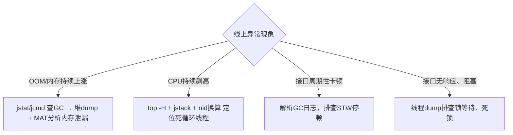

### 9.2 内存问题排查命令
```bash
jps -l                             # 1. 找 Java 进程 PID
jinfo -flags <pid>                 # 2. 查看 JVM 启动参数
jstat -gcutil <pid> 1000           # 3. 实时监控 GC（最轻量排查第一步）
jcmd <pid> GC.heap_info            # 4. 查看堆内存实时信息
jmap -histo:live <pid>             # 5. 存活对象统计 ⚠️触发Full GC，大堆慎用
jcmd <pid> GC.heap_dump /tmp/heap.hprof  # 6. 导出堆快照（大堆会STW，低峰操作）
```
分析工具：Eclipse MAT、VisualVM；重点看**支配树 Dominator Tree**定位泄漏对象。

### 9.3 CPU/线程问题排查命令
```bash
top -H -p <pid>                    # 1. 找到CPU最高线程TID（十进制）
printf "%x\n" <TID>                # 2. 十进制转十六进制 nid
jstack <pid> > threaddump.txt      # 3. 导出线程快照
# 4. 在文件搜索 nid=0xxxxx，定位代码行
```
排查重点：死锁、BLOCKED阻塞、RUNNABLE死循环、无界线程池线程溢出。

### 9.4 GC 日志排查重点
- Young GC频繁：对象分配太快，Eden过小
- GC停顿长：大堆回收、频繁Full GC
- GC回收后堆马上高位：内存泄漏
- safepoint等待时间过长：存在长时间无法进入安全点的线程>
> JDK8 和 JDK9+ GC日志语法不通用。

### 9.5 进阶诊断工具
| 工具 | 用途 | 优势 |
| --- | --- | --- |
| **JFR（Java Flight Recorder）** | GC、线程、锁、IO全链路事件记录 | 开销<1%，JDK11+开源，生产可用 |
| **Arthas** | 在线诊断 trace/watch/heapdump | 无需重启，上手友好 |
| **Async-Profiler** | CPU/内存火焰图 | 采样分析，定位CPU热点代码 |
---

## 10. SpringBoot 业务常见 JVM 问题
- 静态 Map / ConcurrentHashMap 无过期清理 → 堆内存泄漏 OOM
- 动态生成类、Groovy脚本、热部署 → 元空间持续上涨溢出
- 无界线程池 + 阻塞任务 → 线程爆炸 unable to create new native thread
- 一次性加载超大List、大JSON → Eden频繁Young GC
- parallelStream 使用公共ForkJoinPool → 抢占全局业务线程，服务卡顿
- **容器部署** SpringBoot 默认堆取物理内存1/4，必须用`MaxRAMPercentage`适配cgroup，否则被OOM kill
>
> 绝大多数JVM线上故障根源是代码缺陷，不是JVM参数问题。
---

## 11. 生产高频坑点总结
1. 盲目加大 `-Xmx`：掩盖内存泄漏，GC停顿恶化
2. 堆超出容器cgroup限制：进程被系统kill，无OOM日志；使用`MaxRAMPercentage`
3. 生产随意执行heapdump：大堆触发长时间STW，服务卡顿
4. 只关注堆，忽略元空间、直接内存OOM
5. 无限递归引发栈溢出，误判堆OOM
6. 无界线程池 → 线程数量耗尽
7. 将GC停顿误判为业务锁阻塞
8. 本地开发正常、线上OOM：JVM默认参数环境差异
9. 日志、集合无限累加造成隐性内存泄漏
10. 压测忽略JIT预热，性能数据失真
11. `jmap -histo:live` 触发Full GC，生产大堆慎用
12. `String.intern()` 滥用，字符串常量池膨胀，频繁Full GC
13. 堆 >32G，指针压缩失效，内存利用率下降
14. JMM（并发规则）和运行时内存分区（数据存放）概念混淆
15. CodeCache 打满不处理：退化为解释执行，CPU 飙高、吞吐骤降
---

## 12. 核心知识点小结
| 核心模块 | 核心记忆点 |
| --- | --- |
| JVM 架构 | 类加载子系统 + 运行时数据区 + 执行引擎 + JNI |
| 执行引擎 | 解释器保启动、JIT 保峰值；热点探测 + 分层编译 + CodeCache |
| 堆内存 | 对象存储核心区，GC、OOM高发区，分代回收 |
| 虚拟机栈 | 线程私有，存储方法栈帧，递归过深栈溢出 |
| 元空间 | 存储类元数据，动态类、热部署易引发泄漏 |
| 对象的一生 | 创建 → TLAB → 逃逸分析 → 晋升 → 回收 |
| GC 机制 | 可达性分析 + 三色标记，所有GC均存在STW |
| GC 算法 | 标记-清除/复制/整理，新生代复制、老年代整理 |
| 类加载 | 双亲委派保安全，七步生命周期，自定义加载器易泄漏 |
| JMM | happens-before + 内存屏障，volatile/synchronized 语义 |
| 故障排查 | 先定性问题，再 dump 取证，最后调优修复 |
**极简口诀**：
> 对象看堆，调用看栈，类看元空间，字符串看常量池；
> 执行看 JIT，垃圾看三色，出事先定性，取证再修复。
---

## 13. 实操练习建议
1. 自定义无限添加集合代码，小堆参数模拟 `Java heap space` OOM
2. 编写无限递归方法，模拟 `StackOverflowError`
3. 启动 SpringBoot，通过 jcmd/jstat 查看实时堆内存、GC 频率与 JVM 参数
4. 导出线程 dump，识别业务线程、Tomcat 工作线程
5. 开启 GC 日志，压测后解读 Young GC、Full GC 日志信息
6. 手动构造静态缓存泄漏，用 MAT 定位泄漏对象
7. 对比 Node 堆内存限制与 JVM 堆参数的差异
8. 调研 ZGC 低延迟收集器的版本适配与生产使用场景
9. 写一段 `String.intern()` 循环代码，小堆模拟字符串常量池膨胀，观察 Full GC 曲线
10. 在容器里分别用固定 `-Xmx` 与 `-XX:MaxRAMPercentage` 启动，观察内存配额差异
11. **用 `javap -c` 反编译一段简单 Java 代码，对照字节码理解操作数栈**
12. **写一个多线程共享变量的例子，去掉 volatile 观察可见性问题，再加上 volatile 对比**
13. **用 JFR 录制一段压测，分析 GC 与线程事件**
14. **用 Arthas 的 `trace` / `watch` 定位一个慢方法**
15. **用 `-XX:+PrintCompilation` 观察热点方法被 JIT 编译的层级与时机，再用 `jcmd <pid> Compiler.codecache` 查看 CodeCache 水位**
---

## 14. 下篇预告
下一篇：**实战项目：RESTful 后端系统**
核心重点：
- 整合分层架构、REST 接口、参数校验、全局异常处理
- MyBatis-Plus 实战、多环境配置、日志规范、Actuator 监控
- 项目测试、打包、部署完整流程
- 结合并发、JVM 知识梳理线上上线检查清单
阶段 5（并发 + JVM）核心内容完结，下篇进入项目实战收口阶段！